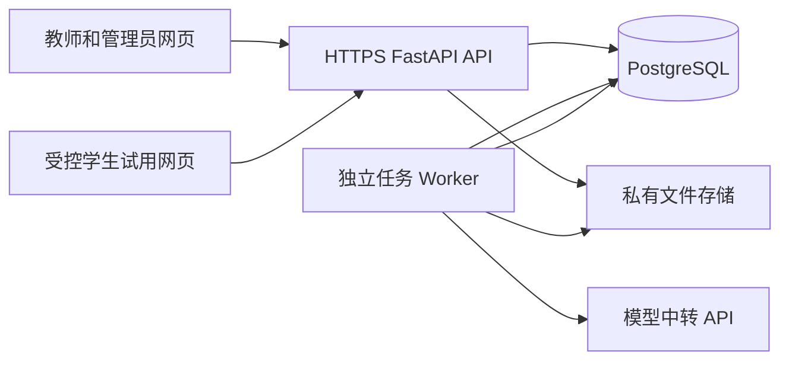

# FastAPI 后端架构与接口设计

2026-10-12，设计稿。后端搭建、真实模型联调和服务器部署均暂停；本轮只交付方案和数据库设计，不创建新的 Python 服务。后续采用 **React + TypeScript 前端、FastAPI 后端、PostgreSQL 数据库**，前后端独立构建、发布。原绿色页面与功能位置保留。

配套资料：[数据库设计](PostgreSQL数据库设计.md)、[建表 SQL](database/postgresql-schema.sql)、[当前前端演示范围](前端检测与学伴试运行.md)。SQL 尚未应用于任何服务器。

## 1. 当前与后续的边界

| 项目 | 当前 Pages 前端 | 后续服务器版本 |
| --- | --- | --- |
| 登录、资料 | 浏览器内教师／管理员身份，按账号保存 | 服务端认证，PostgreSQL 保存工作区 |
| SKILL 检测 | 展示教师方法的有限情境与回复，由教师核对 | 真实 LLM 执行，四维核验，教师确认 |
| 学伴试运行 | 预填完整场景，教师以学生身份连续对话，有限表达匹配 | 教师自行试用和受控学生链接，真实对话 |
| 回收报告 | 本轮没有生成学生报告 | 分析学生实际交互，引用具体证据 |
| 模型密钥 | 不配置，不进入网页 | 仅服务端私有环境变量／凭据服务 |

浏览器核对记录不导入为真实验证资格。旧 Express／SQLite 代码保留作业务逻辑和迁移参考，后续 FastAPI 完成等价验收后再逐块退出，避免同时维护两套正式接口。已有 Docker、Windows 启动文件不代表 FastAPI 已部署。

## 2. 系统结构



API 负责认证、权限、输入校验、短事务和任务提交；Worker 负责模型调用、材料解析、检测和报告。网页不访问数据库、不直接连接模型中转。长模型调用不占用数据库事务，也不要求教师保持页面打开。

前后端分离不要求浏览器跨域：服务器可通过反向代理将 `/api/v1/` 转发至 FastAPI，网页独立部署；继续使用 GitHub Pages 时，网页只配置公开的 HTTPS API 根地址，后端精确允许该网页 Origin。数据库端口只在服务器内部开放。

推荐 Python 3.12、FastAPI、Pydantic 2、SQLAlchemy 2、psycopg 3、Alembic、httpx、PostgreSQL 17。先采用数据库任务队列与独立 Worker，不引入没有实际需求的 Redis、微服务或双数据库。版本应在实施时锁定并完成兼容检查。

建议目录：

```text
backend/
  app/
    main.py                 # 创建应用、公共中间件
    core/                   # 配置、认证、错误与请求编号
    api/v1/                 # 薄路由与请求／响应模型
    domain/                 # 教学规则与状态流转，无 HTTP 依赖
    services/               # 工作区、检测、试用、报告事务
    repositories/           # SQLAlchemy 查询，显式归属条件
    integrations/           # 模型中转、文件解析与存储适配
    workers/                # 领取任务、心跳、恢复、执行
  migrations/               # Alembic，唯一数据库迁移入口
  tests/                    # 规则、真实 PostgreSQL 集成、协议夹具
  pyproject.toml
```

路由不直接拼提示词或执行 SQL；业务规则不写进 React 条件分支作为权限依据。前端未来增加数据服务适配层，保留现有组件；OpenAPI 生成 TypeScript 客户端，Pydantic 与现有 shared 契约做兼容验收，不重新建立整套 UI。

## 3. 账号、权限与工作区

账号只有教师和管理员。学生用限定于某次试用的会话凭据，不注册第三种正式账号。

| 身份 | 允许操作 | 限制 |
| --- | --- | --- |
| 教师 | 自己的草稿、SKILL、学伴、检测、试用和报告；浏览集市 | 不修改他人的 SKILL，不读取他人的对话 |
| 管理员 | 账号启停、模型配置引用、集市治理、运行维护 | 不通过普通教师接口默认获取所有学生对话；显式审核访问须审计 |
| 学生会话 | 读取所属试用的必要介绍，发送及读取自己的对话 | 不访问教师工作区、其他学生会话、检测和报告 |

服务端从会话得到 `owner_id`，忽略客户端提交的作者、管理员身份和“已通过”标志。查询、更新和下载都校验资源归属，UUID 不代替权限检查。注册只生成教师；管理员通过部署端命令创建，不提供公开默认管理员。

密码使用 Argon2id；教师会话使用高熵随机令牌，数据库仅保存 SHA-256 摘要、过期与撤销状态。默认使用 `Authorization: Bearer`，前端内存／当前标签页保存凭据，禁止长期存入 localStorage；退出立即撤销，过期需重新登录。若后续改 HttpOnly Cookie，必须同时实现 CSRF 和跨站 Cookie 策略，不混用未经验证的认证方式。

教师方法仍按七轮梳理，最后提问结束条件，原则可跳过；手动修订优先，缺项只保存草稿。结构化字段单独保存结束条件，不继续把它混进原则。学科包含“任意学科”；四种教学分类、固定分类图标及颜色／自定义上传沿用现规则。

创建项可编辑，集市添加项是只读的固定修订引用。添加不复制所有权，不创建学伴，不覆盖已添加版本。收藏只建立收藏关系。发布明确进入集市，不跳到编辑页；撤下不删除已添加快照和历史证据。集市试用只能展示作者同意公开的教学案例／检测回复，不能暴露学生实际对话。

## 4. SKILL 检测

1. 教师形成完整方法；服务端读取所选工作区项的实际修订，规范化并计算内容摘要。
2. 固定教学模型、设计模型、运行参数和提示词策略版本，创建检测记录与持久任务。
3. 设计模型生成情境，覆盖应触发、不应触发、每个教学步骤、每条原则、结束条件；结束测试至少连续两轮。服务端校验覆盖完整性、步骤下标和输入长度。
4. 教学模型挂载完整 SKILL，逐轮执行；每个输入先保存，每个实际回复及触发轨迹随后保存。失败记录可查看，不生成替代回复。
5. 设计模型核验触发、步骤、原则、结束四维。每项适用结论必须引用实际消息编号与逐字原文，非触发结论也需解释；步骤、原则和结束的证据应包含实际模型回复。
6. 覆盖完整、适用维度全部通过、证据合法，才能进入 `review`。任何失败或无法判断均不获得资格。
7. 教师查看情境、实际回复和结果，确认后进入 `verified`。确认对象必须是该工作区项最新一次检测、当前修订和当前模型策略。

状态：`queued → running → review → verified`；任务错误、执行不符或证据不足进入 `failed`，取消进入 `cancelled`。失败后重新检测创建新记录，保留原证据。重新提交检测即暂停旧资格，避免新检测失败却继续沿用旧结果。

**挂载资格是实时判断，不是一个可永久保留的布尔字段。** 发布、形成可用学伴和开始新试用时，均检查最新检测、方法修订、模型配置及教师确认。方法更新、执行模型或策略变化后重新检测；集市只读添加项可检测，但不能编辑。只更换同一配置的密钥不改变方法版本；模型实际版本无法确认时由管理员发布新的配置修订并安排重检。

## 5. 学伴与受控试发布

沿用基本信息 → 选择 SKILL → 教学场景 → 预览与保存四步。教学场景只有学习对象、学习情境、学习任务与目标；材料、情景化出题和 PBL 活动属于学伴的可选设计，不进入 SKILL 分类。

教师选择自己工作区中的已验证方法。开始试发布时再次检验资格，保存不可变的学伴修订、方法修订与检测证明、实际解析的材料正文、模型配置和上下文摘要。草稿能保存，缺项或未通过的方法不能开始真实试用。教师之后编辑源资料，已开始的试用仍使用原快照；要试用新设计，创建新一轮。

教师先自行试用，然后可创建学生邀请：1–30 名额，1–168 小时。教师自行试用不占学生名额、不计入学生报告。试用可以结束、撤销或过期；轮换邀请只撤销旧邀请，已进入的会话保留；撤销整个试用阻止所有会话继续。

邀请和学生会话用不同凭据，数据库仅存摘要。邀请只用于进入；学生会话只用于自己的后续对话。邀请令牌放 URL fragment，避免出现在 HTTP 路径、代理访问日志或 Referer；进入后交换为受限会话凭据。

进入请求带固定 `request_id`。服务端锁定 trial 行，检查状态、过期、容量和已存在的进入请求，再创建学生会话；并发进入也不能超过人数。网络重试返回同一会话，不占第二个名额。新服务拟用专用私有密钥 HMAC-SHA256 派生学生凭据，输入包含用途、随机 session_id、trial_id 和固定 request_id；数据库存摘要和 credential_version，重试可重建同一凭据而不存明文。密钥独立于模型密钥；轮换保留未过期会话使用的旧密钥版本，直到撤销／过期，不以公开 UUID 直接作为凭据。此设计尚未实现，原 Express 采用重试时轮换凭据。

对话请求带 `request_id`，绑定学生会话和完整请求内容摘要。同键同内容读取已有状态，同键不同内容返回 409。输入先持久化，再由 Worker 调用模型；每次失败尝试保留错误记录，重试不重复输入、不删除失败证据。每个会话同时最多一项未完成对话。

模型根据真实场景、材料和学生输入判断是否触发某项方法、对应步骤及是否结束，返回学生可读回复与结构化轨迹。服务端校验只能引用本轮挂载的方法、合法步骤和本会话消息；不强制每轮触发 SKILL。材料解析失败、无文字扫描件或图片不得假称“已理解”；先明确状态或要求补充可提取文字，预算超限拒绝，不悄悄截断教学目标或原则。

当前模型中转地址是模型上游，**不是项目 API 地址**。地址、模型名称和参数属于非秘密配置，密钥仅私有服务端保存。优先 HTTPS；确需 HTTP 中转时由部署管理员显式允许并记录，浏览器不发送密钥。

## 6. 回收报告与教师改进

结束／撤销／过期后停止接收新输入；已有运行中的请求先完成或明确标记失败。报告只能针对固定输入快照生成，不边接收对话边声称“完整回收”。无学生对话时显示无学生记录，不用教师试用补足数据。

报告分三个方面：学生提问、困难与任务表现；方法触发及步骤／原则／结束执行；不恰当引导、错误回答和运行异常。每项观察或问题至少链接一条该试用的实际学生会话消息；涉及引导和执行的结论引用实际模型回复。证据编号、原文和作用域由服务端再次校验，不采信模型编造引用。网络／模型失败依据独立尝试记录汇总，不因后来成功而删除。

报告保留模型配置、输入摘要、生成版本与错误状态。教师评价追加保存：符合预期、调整场景、修改 SKILL 或扩大试用，并填写说明。修改 SKILL 走重新检测，修改场景走新试用；扩大试用需要显式创建新一轮，不自动向所有学生开放。

固定说明：**仅根据对话记录分析学生表现与教学行为，不能据此认定学习效果已经提升。**“符合预期”是教师对本轮的判断，不是学习成效证明。正式全班应用的发布入口和独立管理策略留到后续确认，不在本轮擅自实现。

## 7. API 合同

根路径 `/api/v1`。日期为 UTC ISO 8601，资源 ID 为 UUID；分页用稳定游标，列表默认20／最多100条。错误统一 `{error: {code, message, request_id, details?}}`，不返回密钥、数据库错误或上游原始敏感头。常见状态：401 会话失效、403 权限、404 不可见资源、409 状态／幂等冲突、422 输入、429 容量／限流、503 服务暂不可用。

| 接口 | 作用与主要输入 |
| --- | --- |
| `POST /auth/register`, `POST /auth/login`, `POST /auth/logout`, `GET /auth/me` | 教师注册、会话、退出、当前身份 |
| `PATCH /admin/accounts/{id}` | 管理员启停教师，保留资料、撤销已有会话 |
| `GET/POST /creation-drafts`, `GET/PATCH /creation-drafts/{id}` | 草稿、七轮问答及教师手动字段，乐观锁版本 |
| `GET/POST /skills`, `GET/PATCH/DELETE /skills/{id}` | 自己的方法、创建新修订、软删除；更新带当前修订 ID |
| `GET /workspace/entries`, `DELETE /workspace/entries/{id}` | 全部／创建／添加列表，移除只读添加项 |
| `GET /market/publications`, `GET /market/publications/{id}` | 集市筛选、说明和获准公开的案例 |
| `POST /market/publications`, `DELETE /market/publications/{id}` | 从自己当前已验证方法发布、撤下 |
| `POST /market/publications/{id}/add` | 只读添加，重复请求返回原工作区项 |
| `GET/POST /favorites`, `DELETE /favorites/{id}` | 收藏关联，不自动添加 |
| `POST /materials`, `GET /materials/{id}`, `GET /materials/{id}/download` | 上传、解析状态、归属受控下载 |
| `GET/POST /companions`, `GET/PATCH/DELETE /companions/{id}` | 学伴工作区和修订，删除前处理开放试用 |
| `POST /companions/{id}/copy` | 复制为独立草稿，只引用方法，不复制 SKILL |
| `POST /detections` | `{entry_id, skill_revision_id}`；202 返回检测 ID 和状态 |
| `GET /detections`, `GET /detections/{id}` | 检测历史、情境、实际消息、结果与错误 |
| `POST /detections/{id}/confirm`, `GET /verifications` | 教师确认、当前可用资格；禁止客户端提交通过状态 |
| `POST /trials`, `GET /trials`, `GET /trials/{id}` | 当前学伴修订、人数／小时；快照、会话和报告历史 |
| `POST /trials/{id}/teacher-session` | 本轮教师自行试用会话，重复返回原会话 |
| `POST /trials/{id}/invitation` | 创建或轮换邀请，明文仅在本次响应返回 |
| `POST /trials/{id}/close`, `POST /trials/{id}/revoke` | 结束或撤销，阻止新输入但保留证据 |
| `POST /public/trial-sessions` | 邀请、昵称、固定 request_id；限流、事务占名额 |
| `GET /public/session` | 学生凭据读取自己的会话和最小必要学伴信息 |
| `POST /sessions/{id}/turns`, `POST /public/session/turns` | `{request_id, content}`；202 返回 turn_id／状态 |
| `GET /sessions/{id}/turns/{turn_id}`, `GET /public/session/turns/{turn_id}` | 轮询实际对话结果；失败不退回样例 |
| `POST /turns/{id}/retry` | 仅重试可恢复失败，新增 attempt，输入和历史错误保留 |
| `POST /trials/{id}/reports`, `GET /reports/{id}` | 202 提交分析、读取具体对话证据 |
| `POST /reports/{id}/reviews` | 教师决定与说明，追加保存 |
| `GET /health/live`, `GET /health/ready` | 存活、数据库和 Worker 就绪，不调用付费模型 |

教师业务写操作使用 `Idempotency-Key`，学生请求使用资源内 `request_id`，与用户／会话、操作和请求摘要绑定；教师幂等记录与资源变更同事务保存。登录／注册按认证规则限流；方法／学伴更新用修订 ID，草稿用 `lock_version` 防止多标签页互相覆盖。重复提交返回原资源，冲突明确提示重新加载；邀请明文不缓存，再次领取须显式轮换，旧资源 ID 不当作凭据。返回卡片、详情、证据 DTO，不直接序列化数据库对象。

示例请求：

```json
{"entry_id":"<UUID>","skill_revision_id":"<UUID>"}
```

检测确认响应至少有 `detection_id`、`status`、`skill_revision_id`、`teaching_model_id`、`confirmed_at`。前端只展示这些状态；后端每次发布、挂载或试用仍独立检查资格。

旧 `/api/execution/*` 按检测／试用／报告一一映射以上端点；`GET /verified` 对应 `/verifications`，学生 `/public/join` 对应 `/public/trial-sessions`。实施迁移时在前端适配层转换字段并完成合同测试，不长期保留两套业务服务。旧浏览器 `entryId` 通过导入映射表转换为 UUID，不直接作为服务端所有权证明。

## 8. 任务、部署与运维

任务与资源同一短事务创建。Worker 用 `FOR UPDATE SKIP LOCKED` 领取任务，更新租约并提交；模型调用后用租约／版本条件写回，避免过期 Worker 覆盖新结果。Worker 心跳延长租约，恢复程序处理过期任务。

上游不支持幂等时不能承诺模型调用“恰好一次”。超时且无法确定是否已执行的请求记录为 `indeterminate`，保留输入、已有回复及调用编号，由教师或恢复策略明确重试；结果保存可做到去重。可恢复的429／短暂连接错误有次数上限和退避，权限、覆盖、证据不合法不自动重试。一期按教师、学生凭据和全局并发限制调用，材料和上下文限制配置化。

服务器后续部署顺序：私有数据库及备份 → Alembic 迁移 → API 和 Worker → 反向代理 HTTPS → 前端 API 接线 → 真实模型与少量学生验收。迁移用独立数据库账号，运行账号没有建表权限；只暴露80／443，数据库、文件和 Worker 均为内部服务。

日志保留请求编号、任务／资源 ID、耗时、错误代码和调用编号，禁止记录 Authorization、邀请／学生明文令牌及模型密钥。学生正文只在受控业务记录中保存，错误日志不复制全文。管理员操作、发布、邀请轮换、删除和教师评价记审计。

先确定数据保留期和恢复目标。一期每日 PostgreSQL 一致性备份、私有文件备份、定期隔离恢复验证；需要更低的数据损失窗口时配置 WAL 归档／PITR。备份包含证据、文件和私有凭据恢复流程；不以“有备份文件”代替恢复验收。监控任务队列长度／租约、模型失败率、磁盘、数据库连接和备份时间。

## 9. 迁移与上线验收

1. 固定现有数据边界，备份浏览器导出和已有 SQLite；不重新清空资料，不改变 `teaching-method.skill-reset.2026-10-10.v1`。
2. 实现账号、材料与工作区 API，保留作者／只读快照／收藏。显式导入当前教师选择的数据，幂等映射旧 ID；不自动导入其他账号或损坏记录。
3. 移植纯教学规则和检测协议，校验结束条件、多轮、完整覆盖、失败保护、修改失效与教师确认。
4. 移植受控试用与证据报告，验证并发名额、幂等、过期／撤销、输入保留、报告逐字引用、教师对话排除和 Worker 重启。
5. 用真实 PostgreSQL 跑接口／事务测试，真实模型由教师评估；前端完成原导航、刷新、上传、手机和跨设备检查。
6. 验证备份恢复与回滚，切换 FastAPI 接线后再移除旧正式运行入口。演示数据只能作为演示归档；真实确认需重新检测，不能升级状态。

保留旧执行记录时标明实际来源和模型身份，字段缺失的记录归档为不可证明，不伪补输入、引用或通过结果。所有实施步骤待后续服务器任务执行，本轮没有启动 FastAPI、PostgreSQL 或真实学生开放。
