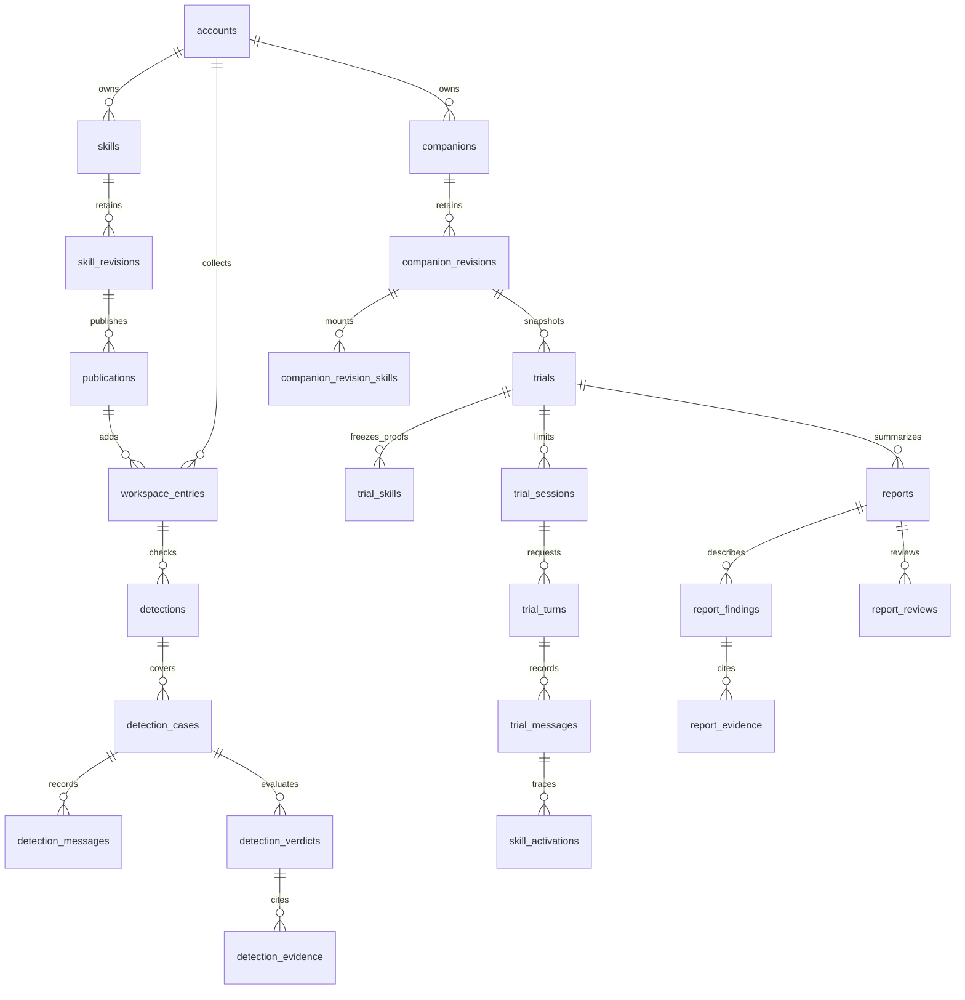

# PostgreSQL 数据库设计

2026-10-12，设计稿，与 [FastAPI 方案](FastAPI后端架构与接口设计.md) 配套。[建表 SQL](database/postgresql-schema.sql) 是 PostgreSQL 17 初始结构，尚未在服务器执行；正式实现时拆为 Alembic 迁移，而非覆盖旧数据库。

## 1. 建模原则

工作区资料、不可变修订、检测证明、试用快照和证据各自保存。方法修订与模型配置固定后才可检测，教师确认后才能发布、挂载和开始试用。修改源资料不改写已有试用、学生消息和报告。界面不显示版本号，内部修订号负责并发与追溯。

主键使用 UUID；时间使用 `timestamptz`，API 输出 UTC；内容和令牌摘要使用32字节 SHA-256。表名和状态使用稳定英文标识，界面翻译保持中文。文件二进制保存在私有对象存储／服务器私有目录，数据库存元数据和提取正文，不保存 Base64。JSONB 用于步骤、头像、不可变上下文和报告输入，不把用户、权限、会话、证据关系藏进一个巨大 JSON。

## 2. 核心关系

ER 图只列主关系，完整外键以 SQL 为准。

## 3. 表与职责

| 领域 | 表 | 主要内容 |
| --- | --- | --- |
| 身份与请求 | `accounts`, `account_sessions`, `api_requests` | 教师／管理员、密码／会话摘要、写操作幂等键 |
| 草稿 | `creation_drafts` | 教师表单、七轮交互、问答位置、乐观锁版本 |
| 模型 | `model_profiles` | 不可变模型配置与策略，凭据引用名，禁止存密钥 |
| 方法 | `skills`, `skill_revisions` | 稳定作者资源、完整内容、结束条件、指令、图标、内容摘要 |
| 我的 SKILL | `workspace_entries` | 创建项／只读添加项，固定来源修订与原作者 |
| 集市与收藏 | `publications`, `favorites` | 验证后发布、撤下、收藏，不产生隐式副本 |
| 文件 | `materials` | 私有文件位置、大小、校验摘要、实际解析正文和状态 |
| 学伴 | `companions`, `companion_revisions` | 名称、头像、三项场景、可选活动、模型和修订 |
| 挂载与材料 | `companion_revision_skills`, `companion_revision_materials` | 修订内有序引用，不复制 SKILL 所有权 |
| 检测 | `detections`, `detection_cases` | 修订／模型绑定、情境覆盖、状态、教师确认 |
| 检测证据 | `detection_messages`, `detection_verdicts`, `detection_evidence` | 实际输入回复、四维判断及同一情境的逐字引用 |
| 试发布 | `trials`, `trial_skills`, `trial_invitations` | 冻结场景／材料、当次证明、人数／期限、邀请摘要 |
| 试用会话 | `trial_sessions`, `trial_turns`, `trial_turn_attempts` | 教师／学生区分、幂等输入、每次调用失败和恢复 |
| 执行轨迹 | `trial_messages`, `skill_activations`, `activation_evidence` | 有序对话、本轮挂载方法、步骤／结束和同会话证据 |
| 报告 | `reports`, `report_findings`, `report_evidence`, `report_reviews` | 固定输入、三方面分析、实际引用和追加教师评价 |
| 运行与导入 | `jobs`, `audit_events`, `workspace_imports` | 有租约的任务、关键操作审计、旧资料幂等映射 |

`trial_skills` 冻结的是**开始本轮试用时采用的检测证明**，而 `companion_revision_skills` 表示学伴设计选择了哪个方法修订。两者用途不同，后续重新检测不改变已开始的试用证明。

## 4. 重要字段与内容规范

- `skill_revisions.steps` 为有序 `{condition, action}` 列表，1–8步；`principles` 可空、最多8条；`ending_condition` 独立必填。旧 `constraints` 中的“结束条件：”只在导入转换，不再当作原则。
- 分类限定课堂提问／错因辅导／智能练习／知识讲解；`subject` 可为任意学科，标签1–5个并排除已移除的 PBL 类标签。分类决定默认图案，`icon` 保存颜色及可选材料 ID；上传遵循原图片类型／大小规则。
- `skill_revisions.state=formed` 校验基本完整性；草稿问答保存在 `creation_drafts`，不制造不完整的可用 SKILL。`current_revision_id` 只指向该资源自身的修订。
- `workspace_entries.source=market` 必须有匹配的原发布、作者、方法与修订；不能改内容或再以自己名义发布。源发布撤下后引用仍可存在，新增添加须先检查公开状态。
- `companion_revisions` 只有 `audience`、`scenario`、`task_and_goals` 三项教学场景；材料关联和情景题／PBL 选项不进入方法定义。
- `context_snapshot` 固定实际提供给模型的正文、场景、运行规则和截取方案，包含材料 ID／内容摘要／解析器版本。未解析附件仅保留状态，不假装作为正文进入上下文。原文件删除走保留策略，不破坏当次文本证据。
- `detections.fingerprint` 绑定方法内容、教学模型配置和运行提示词策略；同时保存设计模型版本便于审计。`confirmed_by=owner_id`，自动检测通过后仍需教师确认。
- `trial_messages` 每个请求最多一个 user 和一个 assistant，按会话 `ordinal` 排序；失败也保留 user 消息。重试追加 attempt，不再追加相同输入。
- `reports.input_snapshot` 保存纳入的学生会话／消息／失败尝试 ID、统计口径和时间边界；`input_hash` 防止分析中输入被悄改，`version_no` 保存重新生成历史。
- `api_requests` 将教师写操作键绑定账号、操作和请求摘要；与资源变更同事务保存，重试返回已有资源。只存资源引用和响应状态，不缓存密钥或邀请明文；多态资源引用由服务端校验归属。学生进入与对话另由 `trial_sessions`／`trial_turns` 的专用唯一键约束。

## 5. 数据库约束与服务端规则的分工

SQL 已包含主外键、状态和长度基础校验、摘要长度、独占来源、固定修订、作者关系、跨账号关联约束、唯一收藏／添加、消息顺序、单会话单待办、幂等请求键和同试用／同情境证据引用。没有级联删除历史证据的 `ON DELETE CASCADE`。

下列语义必须由 FastAPI service **在事务内**完成，不能以“有外键”声称数据库自动完成：

| 操作 | 事务／规则 |
| --- | --- |
| 形成方法 | Pydantic 校验步骤内容、标签、学段／学科、全部必填项；纯规则编译指令；锁资源、插入修订、更新指针 |
| 编辑或导入 | 检查当前修订／lock_version；作者所有权；导入源内容和账号明确匹配；不覆盖只读项 |
| 确认检测 | 锁工作区项与检测；校验当前内容、最新检测、当前模型、覆盖、四维结果及有效逐字证据，再更新确认 |
| 发布／挂载／试用 | 校验所选修订仍是工作区当前引用，最新检测 verified 且模型一致；复制试用上下文和当次证明 |
| 学生进入 | 锁 trial 行；检验邀请／期限／状态；同 join_request_id 校验并返回原凭据；计数仅 audience=student，再新增 |
| 对话 | 校验会话归属、状态、期限、内容摘要和预算；唯一键解决重复请求；提交输入、turn 和 job 后调用模型 |
| 执行证据 | 校验 assistant 角色、挂载方法的合法步骤、原文是所引用消息的子串，且消息属于同会话 |
| 报告 | 检验试用已停止接收、无未决请求、只包含学生；逐字证据和 actual assistant 回复；结果无证据不进入 ready |
| 删除 | 先处理开放试用，再软删除资源；历史修订／对话／报告保留；私有文件清理检查全部引用与保留期 |

`system_passed` 是服务端核验结果，不允许客户端写入；SQL 的 CHECK 不能判断 LLM 是否忠实执行、是否误触发或学习效果是否提升。`confirmed_at` 不代表永久资格：查询资格必须结合工作区当前修订、最新检测和当前模型。默认不启用 PostgreSQL RLS，应用查询显式归属；实施时若加 RLS，需要连接池用户上下文隔离测试，不能当作已实现的安全边界。

修订、配置身份、试用快照和已保存正文在业务接口中不可更新／删除；运行状态与 `enabled` 等控制元数据可变。DB 管理员仍可修复数据，操作必须审计。后续迁移可为不可变表增加只读触发器，当前 SQL 不伪称已强制不可变。

## 6. 索引与并发

主要索引覆盖教师工作区列表、最新检测、学伴试用历史、会话消息顺序、集市公开条目和任务领取。唯一约束防止同方法重复添加、同条目重复收藏、同试用教师会话重复、同 request_id 重复输入、同会话同时两项未完成任务。

学生名额不使用“读 count 后无锁 insert”，始终先锁 trial；任务用 `SKIP LOCKED` 和租约；教师更新用当前修订 ID／草稿 lock_version。不可见资源统一404，权限在查询条件中应用。工作区来源更新不改变已有检测、试用引用的稳定资源 ID。

先用普通 B-tree 和分页；中文搜索按规模选择 trigram／全文检索，不在一期默认增加搜索服务。消息按 session 和 ordinal 查询，不以 JSON 数组不断覆写整段学生记录。大规模后再按时间归档／分区，以真实查询指标决定。

## 7. 生命周期和迁移

软删除隐藏教师资源；撤下隐藏集市入口；关闭／撤销阻止试用写入，历史证据仍可回看。账号停用撤销会话，保留教学资料。数据保留期、学生告知和清理计划在正式上线前确定，定期归档不能孤立删掉报告引用的消息。

现有浏览器键与一次性清理标记均保持。导入在教师登录并选择资料后进行，`workspace_imports` 记录旧 key／ID／摘要到新 UUID，重复导入返回原对象，内容变化要求教师处理，不静默覆盖。旧浏览器密码、管理员标志、Demo 核对结果不能成为真实身份或通过证明。

旧 SQLite 可用离线 ETL 导入账号／真实执行记录；账户密码摘要算法需要明确迁移或重设。模型、情境、逐字证据缺字段时进入历史归档，不补造通过。文件先校验再导入私有存储；导入失败回滚该批并保留源数据库。

建表稿无 `DROP`、样例账号或模型密钥。正式部署分为迁移账号／运行账号，后者不给 DDL 权限；备份恢复必须同时包含数据库、私有文件与服务凭据恢复方案。

## 8. 实施时必须验证

在隔离 PostgreSQL 实例执行 Alembic 升级、空库建表和增量迁移；校验跨账号外键、只读来源、修订指针、同情境／会话证据、重复请求、并发名额和 Worker 争抢。故障测试覆盖模型返回后数据库写入失败、租约过期、重启、报告未决对话、令牌过期／撤销和文件恢复。

本轮通过 PostgreSQL 语法解析器检查60条语句，并静态核对36张表、69个外键的列名／类型／唯一目标和17个索引名称，**未部署 PostgreSQL、未迁移教师数据**。外键和 CHECK 的事务行为须在后续真实数据库集成测试中验收。
