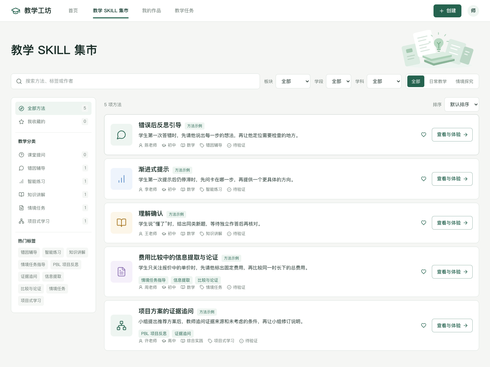

# 教学 SKILL 集市与导航调整说明

更新日期：2026 年 10 月 8 日。修改已在本地预览生效。

## 页面与操作

集市采用白色导航、教育主题轻量 SVG、搜索与组合筛选栏、250px 分类侧栏和横向资源卡片。卡片保留现有五个方法，每项直接展示一句具体教学做法、来源、学段、学科、分类和验证状态，右侧提供收藏与「查看与体验」。内置案例标注「演示案例」，验证状态为「待验证」。

默认展示日常教学与情境探究的全部方法。板块下拉框和快捷切换使用同一筛选状态；搜索覆盖名称、简介、教学做法、作者、场景与分类。搜索、板块、学段、学科、主要分类和标签共同生效。分类及收藏数量按当前搜索、板块、学段、学科和标签下的实际数据计算；结果数量与展示条目一致。

六种主要分类互斥，标签可再次点击取消。排序提供现有数据顺序和中文名称排序，没有增加虚构的推荐或更新时间。无匹配结果可清除全部筛选；收藏为空时可以返回全部方法。收藏复用既有 localStorage 数据，刷新后保留。搜索与筛选保存在 sessionStorage，详情返回时恢复筛选和列表滚动位置。

手机端隐藏固定侧栏，使用白色「筛选分类」弹窗；卡片改为紧凑纵向排列。弹窗分类与标签有至少 44px 的触控高度，超出高度的分类内容可滚动。

详情页继续展示教学目的、触发条件、条件与做法、原则、来源和示例。体验区域明确标注「模拟体验」，输出预设的首步引导；「复用到我的作品」继续复制原有方法并保留来源，复制后可以编辑。

## 此前提出的调整

- 日常教学标题、主卡片外框与底部两个按钮居中；10 月 9 日按新反馈将卡片内图标、标题和主操作也居中，保留精简文案。
- 所有多行文本输入改为自动增高，不显示拖拽缩放手柄。普通表单保留明确提交按钮；对话输入采用统一圆角输入区与发送按钮，回车发送、Shift+回车换行，并处理中文输入法组合输入。
- 界面固定文案统一使用 **SKILL**，类型名、变量名、路由和存储键保持原样。
- 「师生使用空间」改为「教学任务」：选择教学方法或已保存作品 → 填写任务要求 → 创建任务 → 学生预览 → 查看提交记录。提交后的提示作为可展开设置。
- 详情与作品的「用于教学」改为「布置任务」。查看方法后再次布置任务不会形成相互返回的循环；从任务页编辑作品后仍可返回任务表单，内容不丢失。
- 移除集市中的教学助手库跳转；报告操作结束后回到「我的作品」。保留旧助手数据及旧链接兼容访问。

自动增高复用 [react-textarea-autosize](https://github.com/Andarist/react-textarea-autosize)，对话输入由已有 Button 和该组件组合。控件组合参考 [shadcn Input Group 官方文档](https://ui.shadcn.com/docs/components/radix/input-group)，未复制 GPT 或扣子的私有实现。

## 修改文件清单

路径相对于 `main/`，按功能分组列出。

| 功能 | 文件 |
| --- | --- |
| 新集市页面与分类组件 | 新增 `src/features/marketplace/MarketPage.tsx`、`MarketCategories.tsx` |
| 筛选、分类与排序 | 新增 `src/features/marketplace/market-catalog.ts` |
| 资源卡片与响应式样式 | 新增 `src/features/marketplace/market-catalog.css` |
| 教育主题装饰 | 新增 `public/market-learning.svg` |
| 详情模拟体验与原有操作 | 修改 `src/features/marketplace/MarketPages.tsx` |
| 统一自动增高与对话输入 | 新增 `src/components/ui/textarea.tsx`、`src/components/ChatComposer.tsx` |
| 创建页输入与 SKILL 文案 | 修改 `src/features/designer/MethodTextField.tsx`、`MethodOutline.tsx`、`GuidedMethodPage.tsx`、`DesignerChat.tsx`、`DesignerPage.tsx`、`creation-flow.css` |
| 探究输入与任务入口 | 修改 `src/features/inquiry/DesignFields.tsx`、`InquiryEditor.tsx` |
| 任务布置与学生预览 | 修改 `src/features/space/UsageSpace.tsx`、`TaskPreview.tsx` |
| 对话输入复用 | 修改 `src/features/usage/UsePage.tsx`、`StudentPreviewPage.tsx` |
| 首页与日常教学入口 | 修改 `src/features/marketplace/LandingPages.tsx` |
| 导航与来源返回 | 修改 `src/App.tsx`、`src/lib/routes.ts`、`src/components/AppHeader.tsx` |
| 作品操作、展示文案 | 修改 `src/features/workshop/WorkshopPage.tsx`、`src/data/marketplace.ts` |
| 公共空状态 | 修改 `src/components/Workbench.tsx`，增加空状态标题参数 |
| 输入、日常教学与任务样式 | 修改 `src/styles/workbench.css`、`workbench-resources.css`、`workbench-spaces.css`、`marketplace.css`、`usage-new.css` |
| 输入组件依赖 | 修改 `package.json`、`package-lock.json` |
| 新验收场景 | 新增 `tests/market-catalog.spec.ts`；修改 `tests/inquiry-navigation.test.ts`、`trial-preview.spec.ts`、`marketplace.spec.ts` |
| 文案与原有流程选择器 | 修改 `tests/customer-navigation.spec.ts`、`creation-flow.spec.ts`、`workbench-ui.spec.ts`、`assistant-platform.test.ts`、`marketplace.test.ts`、`platform-services.test.ts`、`teaching-method.test.ts` |
| 说明与截图 | 本文、`README.md`、`docs/UIUX统一重构说明.md`、`docs/assets/` 下的相关验收截图 |

## 验收结果

| 检查 | 结果 |
| --- | --- |
| TypeScript 与 Vite 生产构建 | 通过 |
| 单元与集成检查 | 36 / 36 通过；最后修正返回关系后，相关 4 项再次通过 |
| Playwright 交互场景 | 20 个场景已通过；首轮发现 3 项问题，修复后对相关 3 项复验通过 |
| 最终手机样式 | 分类面板、控件换行和手机卡片再次通过相关场景验证 |
| 页面适配 | 390、768、1280、1440px 的 17 个原有主要页面无横向溢出 |
| 集市 | 搜索、组合筛选、真实计数、板块同步、标签、排序、收藏为空、搜索为空、收藏刷新保持、详情返回通过 |
| 输入框 | 自动增高、无拖拽手柄、Shift+回车换行、回车发送、中文组合输入不误发送通过 |
| 教学任务 | 方法详情往返、原作品编辑往返、表单恢复和学生提交返回通过 |
| 原有功能 | 创建与教师手动修改优先、独立探究成果、复用、副本、挂载、分享展示、导出及旧链接兼容通过 |

最终构建成功，保留原有依赖注释与约 517KB 脚本包的构建提示。筛选数据在浏览器内同步读取，无异步网络加载过程。模拟体验与预置方法仍需真实教学验证；本轮没有接入真实模型。

## 验收截图

[手机集市](assets/SKILL集市手机.png) · [日常教学卡片居中](assets/日常教学卡片居中.jpg) · [教学任务](assets/统一重构-教学任务-1440.png) · [学生对话预览](assets/统一重构-学生对话预览-1440.png)
