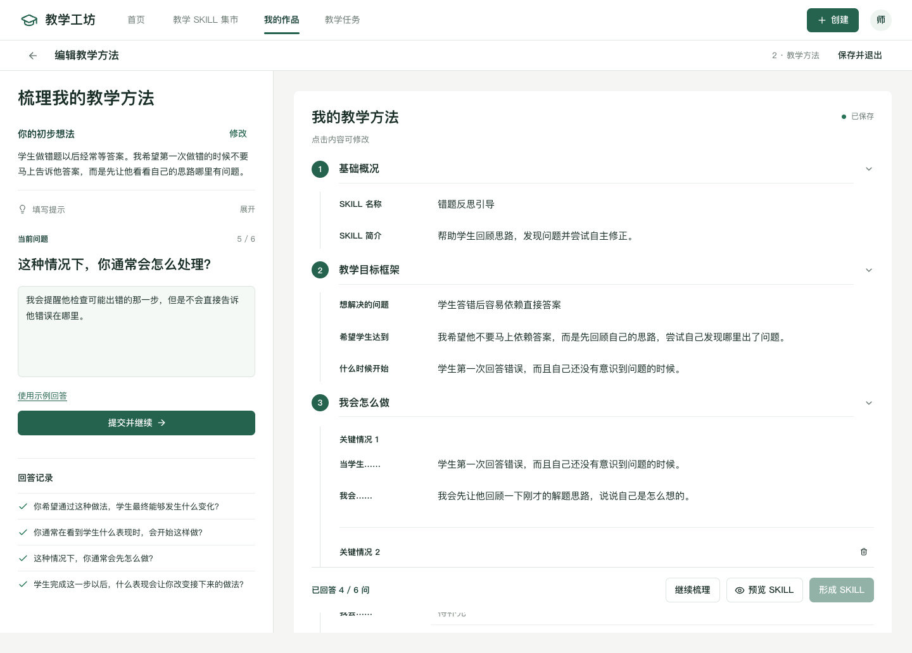
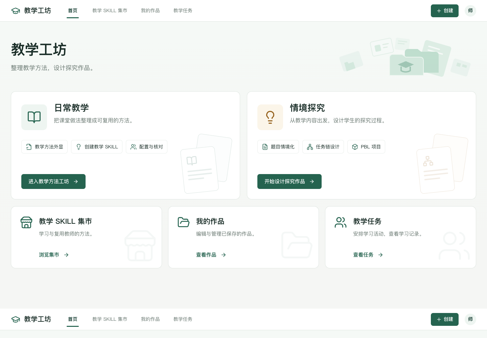
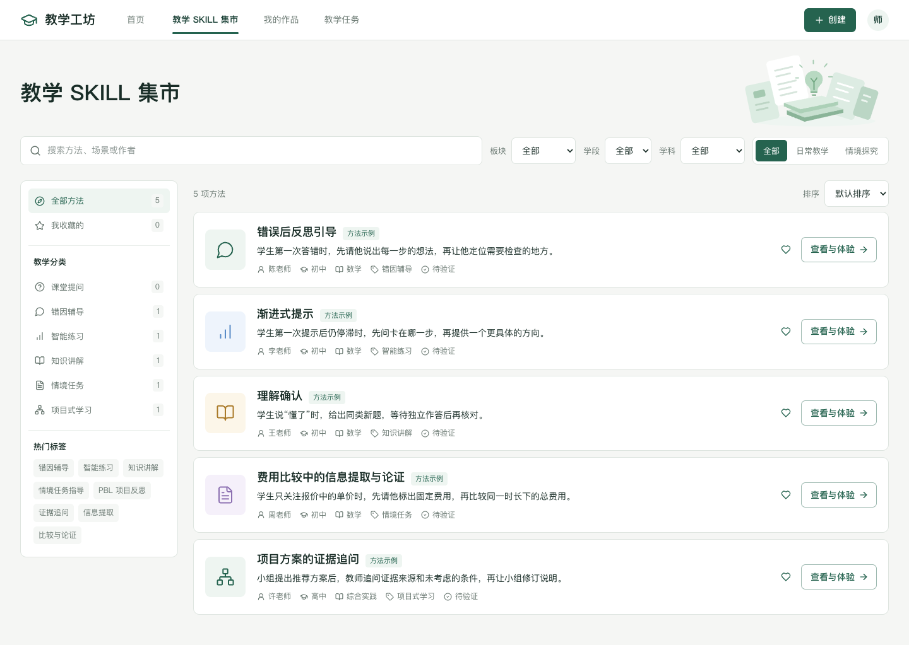

# 教学工坊全站 UI/UX 统一重构说明

更新日期：2026 年 10 月 8 日。本次在现有本地项目中完成，未上传 GitHub。

本文记录此前的全站重构。后续集市分类与资源卡片、自动增高输入、教学任务命名和返回关系的调整，见 [SKILL 集市与导航调整说明](SKILL集市与导航调整说明.md)。

## 结果与范围

全站采用白色导航、浅灰绿色页面底、白色内容区和深绿主按钮。创建教学方法改为接近全屏的宽屏 3:7 工作区；教学目标、关键情境、原则和结束条件以绿色圆形编号组织。首页、探究、集市、我的作品、检测与试用、师生使用空间及两类学生预览沿用同一套视觉规范。

保留原有路由、来源返回、教学方法梳理、独立探究成果、保存恢复、收藏复用、导出、副本、挂载与学生预览交互。本次没有更改共享数据结构、存储键、后端、模型接入或依赖清单。未清理用户 localStorage。浏览器验收使用独立测试上下文和虚构教学样例。

## 视觉规范

| 用途 | 颜色或尺度 |
| --- | --- |
| 主色 / 主按钮 | `#25634F` |
| 深绿 / 强调文字 | `#183F34` |
| 焦点 / 悬停强调 | `#327C61` |
| 浅绿状态背景 | `#EEF5F1` |
| 页面底 / 内容底 | `#F5F6F4` / `#FFFFFF` |
| 主文字 / 次文字 | `#192D27` / `#66756E` |
| 边框 / 分隔线 | `#DEE5E0` / `#E9EEEA` |
| 中文字体 | 苹方、微软雅黑和系统无衬线字体 |
| 页标题 / 模块标题 | 主要为 26–28px / 18–20px |
| 正文 / 辅助文字 | 14–15px / 12–13px |
| 桌面导航 / 工作区工具栏 | 64px / 48px |
| 通用控件 / 主操作 | 38px / 42px；手机按钮至少 42px |

基础颜色集中在 `src/styles/tokens.css`，通过 Tailwind 的公共 CSS 入口加载，使 shadcn 组件的背景和文字颜色实际生成。创建、预览和确认弹窗使用白色背景；遮罩不再模糊页面。主按钮、次按钮、禁用、焦点、选中、警告与错误状态一致。主要内容区无渐变、玻璃背景或大面积装饰。

公共布局分为三份样式文件：`workbench.css` 管理导航、表单、编号分组与反馈；`workbench-resources.css` 管理入口和资源列表；`workbench-spaces.css` 管理探究、检测与使用空间。原有页面样式继续承担各页面的内容结构，删除过时的 `customer-presentation.css` 覆盖层。

## 页面效果

| 页面 | 最终呈现与交互 |
| --- | --- |
| 首页 | 只保留标题、日常教学和情境探究两个入口，以及三条导航；移除标签和重复说明 |
| 日常教学 | 白色内容入口，直接开始整理教学方法，也可参考集市或继续个人作品 |
| 创建教学方法 | 当前问题和教师方法优先；填写提示默认折叠，字段阅读状态无框线，接近字数上限时才提示；保留五个编号模块和底部操作 |
| 情境探究入口 | 三类成果纵向排列，以浅分隔线区分；各自独立选择，示例由教师主动填入 |
| 情境题目编辑 | 原题与目标在左、可编辑情境内容在右；保留条件核对、学生预览、保存与导出 |
| 任务链编辑 | 左侧教学背景、右侧编号任务；添加、删除、上下移动和核对仍可使用 |
| PBL 编辑 | 以项目、目标与阶段、任务与资源、成果、评价与实施五组组织字段；实施条件在左侧 |
| 教学 Skill 集市 | 名称下直接展示一句具体教学做法；作者、学段学科、场景与验证状态合并为一行；收藏和体验入口并列 |
| Skill 详情 | 方法说明与体验区分栏；教学步骤用绿色圆形编号呈现，保留复用和用于教学 |
| 我的作品 | 分类导航和紧凑作品行，全部操作可见并随屏宽换行；旧助手与作品展示仍保留 |
| 检测与试用 | 桌面约 60:40，左侧情境核对、右侧方法结果；明确区分内容核对与实际执行效果 |
| 师生使用空间 | 左侧布置任务、右侧所选内容预览，下方任务列表；内容选择与任务表单可恢复 |
| 学生学习预览 | 白色阅读区、清晰任务步骤、大输入区；支持刷新恢复、逐项完成、提交与返回 |
| 学生对话预览 | 统一对话、输入、示例和返回样式；保留从具体试用记录或报告返回的来源 |
| 助手库、记录与报告 | 沿用原有功能，颜色、边框、搜索、状态与导航统一为当前工作台规范 |

桌面创建页两栏分别滚动，底部操作可见。900px 以下变为上下布局；手机方法操作区随内容排列，避免遮住字段。探究编辑在小屏同样堆叠；集市和作品操作换行，导航保持可见。

## 创建页的真实交互

教师提交回答后仍使用现有整理规则同步字段，对应模块短暂浅绿高亮。教师手动编辑的目标或做法不会被后续问答覆盖。保存状态来自实际 localStorage 写入：成功显示已保存与当前时间；失败显示错误并保留页面内容。

「继续梳理」定位当前回答框；问答完成后可补充情况。「预览 Skill」随时展示当前方法，只读查看后可关闭返回编辑。「形成 Skill」保留既有完整性检查与教师确认流程。填写项目数量用于说明进度，不是教学智慧评分。

「结束条件」是选填项，仍保存于现有 `principles` 数组，使用明确的「结束条件：」文本前缀；形成 Skill 时沿用原有 `constraints`，不新增数据字段。删除该项内容不会保留空的结束规则。

填写提示默认折叠，梳理记录在实际回答后出现。阅读状态保留教师原话，点击后才显示输入框；500 字限制不变，达到 450 字时显示剩余字数。移除不支持拖动的装饰标识与嵌套框线，保留清晰的分组和焦点状态。字段切换时避免上一编辑框失焦收起移动点击目标。

没有增加流程不支持的换问法、跳过或自动生成按钮。

## 数据与真实性

所有原有浏览器存储键保持一致。作品依旧独立保存；上游修改会保留教师内容并撤销相关确认。来源参数与返回逻辑没有改写，刷新后仍可恢复作品分类、集市筛选和布置任务内容。

教学方法、引导回复和报告中的预置内容保留「示例」标识。检测页面明确显示「实际 Agent 执行表现待验证」。没有调用真实 LLM、编造教育评分或增加真实学生账户。分享展示仍仅保存于本地浏览器。

## 运行方式

需要 Node.js 24 和本机 Chrome。在应用目录执行：

```bash
cd '/Users/wensifan/Desktop/doctor/teacher ai community /main'
npm install
npm run dev
```

访问 [教学工坊本地预览](http://127.0.0.1:5173/#/home)。当前开发预览已启动，服务只监听 `127.0.0.1`。用户浏览器原有草稿可直接继续使用。

```bash
npm test
npm run build
npm run test:e2e
```

E2E 运行时保持开发服务启动。

## 验收结果

| 检查 | 结果 |
| --- | --- |
| TypeScript + Vite 构建 | 通过 |
| 本轮相关 Playwright 流程 | 6 / 6 通过，覆盖首页、集市、创建编辑、保存恢复、预览与响应式布局 |
| 上一轮统一重构基线 | 单元与集成测试 35 / 35，完整 Playwright 流程 17 / 17 通过；本轮未重复运行全量测试 |
| 响应式页面检查 | 390、768、1280、1440px，17 个主要页面无横向溢出 |
| 创建页 | 问答、手动修改优先、折叠、预览、结束条件恢复、形成 Skill 验证通过 |
| 作品流程 | 独立保存、刷新恢复、导出、副本、收藏、分享展示、挂载和来源返回通过 |
| 学生预览 | 单题、任务链、PBL 的记录、提交、刷新恢复和返回通过 |
| 弹窗 | 创建窗口实际白色背景检查通过，关闭与键盘 Esc 可用 |
| 视觉检查 | 检查首页、创建、探究三类编辑、集市、详情、作品、检测、使用空间与学生预览截图 |

构建仍有依赖包注释处理和约 506KB 脚本包体积提示，构建成功；本次没有调整依赖或拆包方案。实际模型效果与跨设备持久化仍未接入。

## 页面截图

以下为独立浏览器测试上下文中的虚构教学样例截图。







[创建入口弹窗](assets/创建入口弹窗.png) · [情境探究入口](assets/统一重构-探究入口-1440.png) · [情境题目](assets/统一重构-情境题目工作区-1440.png) · [任务链](assets/统一重构-任务链工作区-1440.png) · [PBL 项目](assets/统一重构-PBL项目工作区-1440.png) · [我的作品](assets/统一重构-我的作品-1440.png) · [师生使用空间](assets/统一重构-师生使用空间-1440.png) · [学生学习预览](assets/统一重构-学生学习预览-1440.png) · [手机创建页](assets/统一重构-教学方法工作区-390.png)

## 修改文件清单

以下代码和测试清单根据修改前文件摘要比对生成；路径均相对于 `main/`。另更新 `README.md`、`docs/教法集市升级说明.md`，新增本文及 `docs/assets/统一重构-*.png` 验收截图，更新现有客户演示截图。

| 操作 | 文件 |
| --- | --- |
| 修改 | `src/components/AppHeader.tsx` |
| 新增 | `src/components/Workbench.tsx` |
| 修改 | `src/components/ui/dialog.tsx` |
| 修改 | `src/features/designer/DesignerPage.tsx` |
| 修改 | `src/features/designer/GuidedMethodPage.tsx` |
| 修改 | `src/features/designer/IdeaForm.tsx` |
| 新增 | `src/features/designer/MethodOutline.tsx` |
| 新增 | `src/features/designer/MethodPreview.tsx` |
| 修改 | `src/features/designer/creation-flow.css` |
| 修改 | `src/features/inquiry/ChainEditor.tsx` |
| 修改 | `src/features/inquiry/DesignFields.tsx` |
| 修改 | `src/features/inquiry/InquiryStartPage.tsx` |
| 修改 | `src/features/inquiry/PblEditor.tsx` |
| 修改 | `src/features/inquiry/ProblemEditor.tsx` |
| 修改 | `src/features/marketplace/LandingPages.tsx` |
| 修改 | `src/features/marketplace/MarketPages.tsx` |
| 修改 | `src/features/testing/SkillResults.tsx` |
| 修改 | `src/features/testing/TestingPage.tsx` |
| 修改 | `src/main.tsx` |
| 修改 | `src/styles/base.css` |
| 删除 | `src/styles/customer-presentation.css` |
| 修改 | `src/styles/designer-new.css` |
| 修改 | `src/styles/library-new.css` |
| 修改 | `src/styles/testing-new.css` |
| 修改 | `src/styles/tokens.css` |
| 修改 | `src/styles/usage-new.css` |
| 新增 | `src/styles/workbench-resources.css` |
| 新增 | `src/styles/workbench-spaces.css` |
| 新增 | `src/styles/workbench.css` |
| 修改 | `tests/customer-navigation.spec.ts` |
| 新增 | `tests/workbench-ui.spec.ts` |
