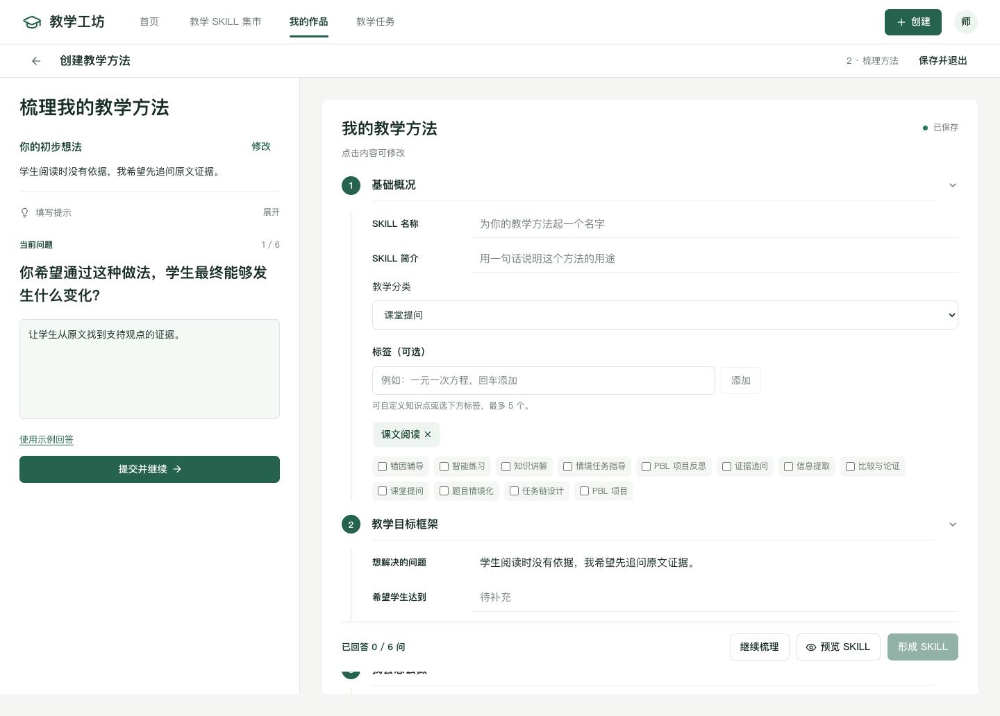

# 教学工坊：功能需求与易用性审查

审查日期：2026 年 10 月 9 日。

本次按“是否满足已约定功能需求”和“教师能否简明完成任务”两项标准审查当前客户演示版本，以最新聊天约定为准。

结论：前端主要业务流程已覆盖约定范围，明确的保存恢复与操作可靠性问题已修正。教师经验能够结构化表达和核对；真实执行、学生发布及教育效果验证仍未接入。

## 逐项结论

| 教师任务 | 功能需求核对 | 简明好用核对 |
| --- | --- | --- |
| 找到工作入口 | 首页五个入口连接已有流程，教学助手库不再作为公共入口。 | 两条主路径突出，能力说明不冒充按钮，首页没有统计模块。 |
| 梳理教学方法 | 六轮回答分别进入目标、触发、条件与做法、原则；教师直接修改优先，补充及结束条件保留，确认后才封装。 | 一次一个问题；未提交回答和补充可恢复；方法草稿可在我的 SKILL 中继续梳理。 |
| 尽量说全教学经验 | 问题覆盖核心结构，允许继续补充及最终复现确认。 | 不要求教师先了解技术格式；目前仍是固定六问，没有自适应追问或完整性自动判断。 |
| 将经验转为 SKILL | 最终方法与打包字段一致，条件、做法、问题、目标及原则保留，不覆盖其他方法。 | 进度显示已回答问题数或关键内容是否完整，不再把可选名称、简介混入必填完成率。实际执行未实现。 |
| 设计探究成果 | 情境题目、任务链与 PBL 可独立开始、确认、保存、复制及导出；自定义内容不套用数学答案。 | 按成果进入编辑，PBL 条件逐项确认，可保留草案，不强制绕完三个层级。 |
| 浏览复用集市方法 | 搜索、筛选、收藏、详情与独立副本有效，来源保留。 | 列表展示一句具体做法；应用与复制分开，失败停留原页面并可重试。 |
| 管理作品 | 分类、搜索、排序、真实数量、编辑、复制、收藏、展示、加入助手配置和删除有效。 | 草稿标明尚未形成 SKILL，空占位不显示为作品；次要操作收进菜单，删除范围与失败结果明确。 |
| 布置学习活动 | 只选择已确认作品，活动设置独立保存，智能支持可选，草稿与学生预览快照一起保存。 | 四步完成，支持可跳过，时间错误就地提示，已有提交的活动调整另建副本。真实发布尚未开放。 |
| 应用教学 SKILL | 方法、版本、目标、范围与模拟独立配置，内容变化使旧模拟失效。 | 与学习活动共享框架，但不套用学生任务表单；无法运行的助手目标不可操作。正式启用尚未开放。 |
| 学生视角体验 | 填写、逐项完成、刷新恢复、提交及本机记录有效，一次提交规则有效。 | 返回对应活动，保存失败不报提交成功。是教师预览，不是正式学生账户或学习分析。 |
| 核对与报告 | 使用当前方法和版本，不编造调用、分数、使用量与效果；分享不激活方法。 | 核对保存失败保留当前项并可重试，报告区分固定表达与真实执行待验证。 |

## 本轮直接修正

1. 未提交回答及补充情况／做法改为可恢复草稿；提交后才更新方法，下一题不会继承上一题输入。
2. 最终确认不再忽略正在填写的补充，须先保存或取消；所有情况补充入口遵守八项限制。
3. 未完成方法进入我的 SKILL，可直接继续梳理；已形成方法与草稿分开计数，仅打开页面形成的空占位不混入作品。
4. 副本、收藏、展示、加入助手配置及删除只有持久化成功才应用结果；失败不生成幽灵副本、不报成功、不关闭确认弹窗。
5. 删除草稿和核对进度延后到主记录保存成功之后；失败保留原方法与恢复信息，历史任务快照继续保留。
6. 中途核对和最终状态保存失败可重新确认，不进入完成页；试用及报告分享也检查保存结果，多个方法的展示设置一次保存。
7. 保存并退出主动重试；方法及探究编辑保存失败时，公共导航、返回及刷新有离开保护。探究页不再一边保存失败，一边显示自动保存。
8. 项目指导方法沿用已有草稿恢复逻辑，去掉重复直接写入；PRODUCT.md 更新为当前业务合同，区分历史六步实现。

## 仍需后续实现

| 能力 | 当前实现 | 后续需要 |
| --- | --- | --- |
| 自适应追问与任意学科生成 | 固定问题、教师编辑框架。 | 模型接入、内容校验和证据保存。 |
| SKILL 实际执行及验证 | 内容核对、固定表达、规则模拟。 | 运行环境、触发／约束／退出控制和执行轨迹。 |
| 正式发布与学生使用 | 本机草稿、学生视角预览、对象配置。 | 学生访问、授权、发布、时间安排和真实提交服务。 |
| 学习分析与跨设备协作 | 本机记录，无效果评估与同步。 | 真实数据、账号与同步，以及教育效果评估。 |

这些能力不能用前端成功提示或虚构数据补齐，本轮没有擅自接入后台或模型。易用性结论来自页面与任务流程检查，尚未开展真实教师访谈或完成时间测量。

## 验证与改动位置

改动集中于方法草稿、作品目录与操作回调、两套本机存储 Hook、核对页面、保存失败离开保护和 App 路由分发。新增交互回归在 `tests/functional-audit.spec.ts`，纯规则检查补充于 `tests/workshop-catalog.test.ts`。

- TypeScript 与 Vite 构建通过；保留已有 Zod 注释及打包体积的非阻断提示。
- 26 项相关纯规则检查通过，覆盖方法封装、作品独立性、草稿分类、应用兼容性和版本失效。
- 44 项浏览器交互检查通过，其中 11 项为本轮新增功能回归；覆盖创建、保存恢复、复制、删除、核对、双路径教学活动、学生提交与返回。
- 保存失败夹具验证了当前输入保留、失败不报成功、弹窗内重试及导航保护。修正了合成哈希事件过早同步路由的问题，避免编辑页先被卸载再恢复。
- 390、768、1024、1280、1440、1672px 的相关页面检查通过，主要入口、活动操作和作品菜单无横向溢出；收集错误的主要闭环没有出现新的运行时或控制台错误。

测试使用隔离工作区，没有覆盖用户的浏览器作品，没有调用真实模型。当前用户工作区检查后已返回首页，未上传。

本地入口：[教学工坊](http://127.0.0.1:5173/#/home)。
