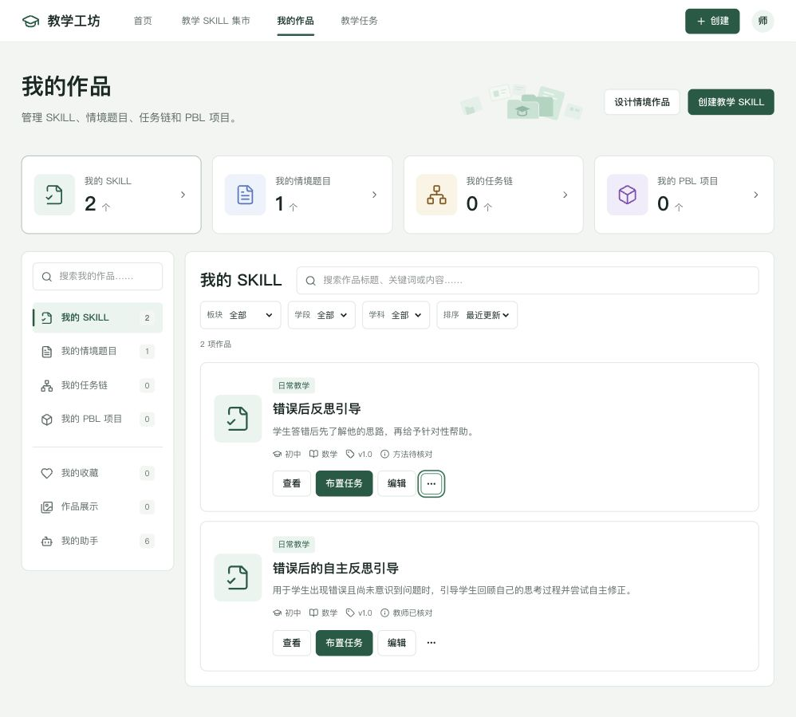
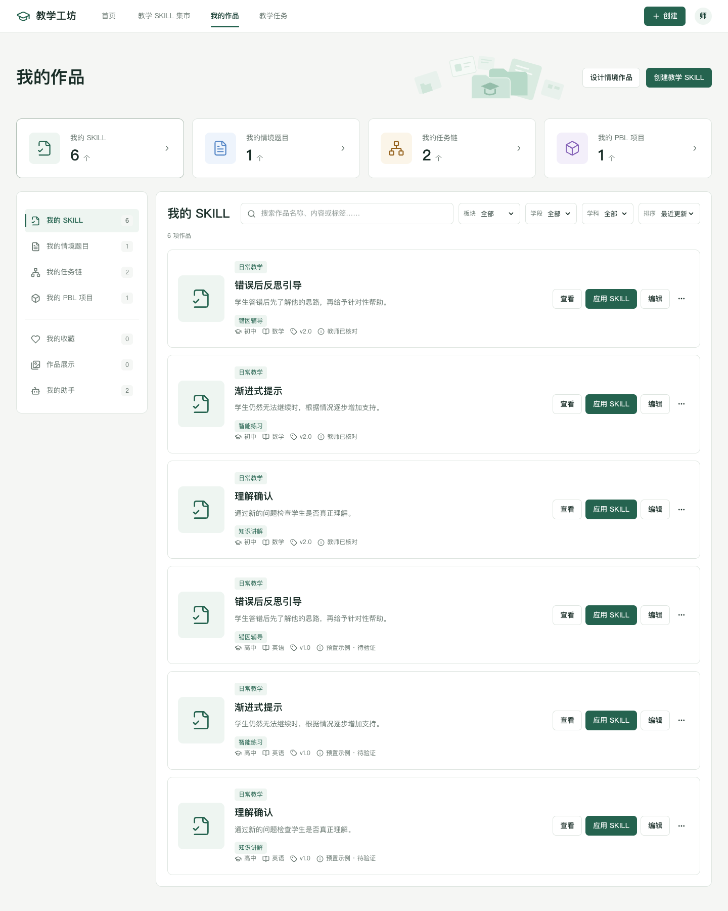
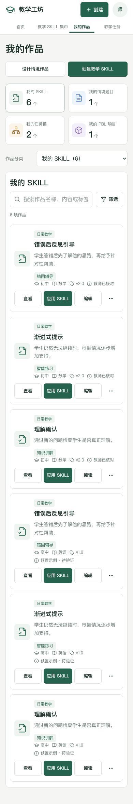

# 我的作品页面重构说明

更新日期：2026 年 10 月 9 日。

「我的作品」已改为作品概览、分类侧栏与资源管理列表。沿用集市的绿色品牌、白色卡片和浅色背景，将复制、收藏、分享、挂载与删除收进「更多」菜单。仅修改本地项目，未上传 GitHub。

## 页面与交互

| 区域 | 已实现行为 |
| --- | --- |
| 标题区 | 「设计情境作品」进入现有探究创建流程；「创建教学 SKILL」进入教学方法梳理流程。 |
| 四张概览卡 | 按真实资源计算 SKILL、情境题目、任务链、PBL 数量，点击切换分类。没有写死参考图中的数字。 |
| 左侧分类 | 教学成果、收藏、展示、助手分组；全局搜索匹配标题、简介与教学内容，并显示各分类的匹配数量。 |
| 右侧工具栏 | 当前分类搜索、适用的板块筛选、学段、学科以及最近更新／最近创建／名称排序共同生效；支持清除。 |
| 资源卡片 | 显示类型、名称、简要内容和真实状态；情境题含知识点，任务链含任务数和情境主题，项目含阶段数。 |
| 主要操作 | 标题或「查看」进入对应详情／预览；「编辑」进入现有编辑器；可用内容进入已有教学任务配置和学生预览流程。 |
| 更多菜单 | 按资源类型提供复制、收藏切换、展示切换、挂载及删除；支持键盘打开、Escape 关闭与焦点返回。 |
| 删除弹窗 | 显示名称及实际影响范围；取消不改变数据，确认后列表与计数同步变化。 |
| 手机布局 | 概览两列、分类选择器、筛选自动换行、作品信息与操作上下排列。 |

顶部概览显示分类总量；左侧数量随全局搜索变化；右侧数量为所有当前筛选条件共同匹配的结果。三者都从同一份原有作品数据派生，不另建展示数据。

每个分类分别保留搜索、筛选与排序；全局搜索在分类之间共享。进入详情、编辑器或教学任务后返回，会恢复原分类和筛选。当前浏览器标签页刷新也能恢复这些条件与列表滚动位置。

## 数据、使用与复制规则

- 使用原有助手、SKILL、情境设计和工作区持久化数据，兼容既有 localStorage 格式。新增的 sessionStorage 只保存筛选与滚动位置。
- 已保存的各层成果和当前正在编辑的草稿都会保留在对应分类中；情境成果仅在内容完整并经教师核对后显示「布置任务」。状态由现有规则判断，不新增验证分数。
- SKILL 复制和挂载沿用原有独立副本逻辑，保留教学语义；挂载可选择其他已有助手，每个助手最多 8 项能力，并保留目标助手原有 SKILL。
- 情境设计复制仍复制完整设计，包括已有关联成果；复制后进入本次选择的成果层级。PBL 副本的项目名增加「（副本）」，原设计、任务内容和原项目名不变。
- 删除单项 SKILL 保留助手其他方法；删除助手会移除其挂载方法；删除情境设计会一并移除关联题目、任务链和项目。已布置任务使用独立快照，不随源作品删除。
- 收藏支持已有 SKILL 与情境成果，并与集市共用状态。来自集市的收藏进入原详情，提供复用、挂载和取消收藏，不能直接编辑或删除原资源。
- 「作品展示」包括当前教师主动展示的 SKILL 与情境成果，明确标注当前工作区可见，未创建公网发布或跨设备分享。
- 「我的助手」单独显示助手状态与已挂载能力数量，沿用原编辑、检测或试用记录入口。
- 旧 SKILL 记录没有独立时间字段，排序沿用所属助手的真实创建和更新时间；无时间的外部收藏保持稳定顺序，不伪造日期。

## 修改文件

| 文件 | 用途 |
| --- | --- |
| `src/features/workshop/WorkshopPage.tsx` | 页面布局、分类、筛选恢复、交互分发。 |
| `src/features/workshop/WorkshopNavigation.tsx` | 实际数量概览、分类侧栏、手机分类选择器。 |
| `src/features/workshop/WorkshopResourceCard.tsx` | 各类资源信息与主次操作、更多菜单。 |
| `src/features/workshop/WorkshopDialogs.tsx` | 删除范围确认、已有助手挂载。 |
| `src/features/workshop/workshop-catalog.ts` | 从原数据派生分类，搜索、过滤、真实日期排序。 |
| `src/features/workshop/workshop-types.ts` | 页面回调与数据属性类型。 |
| `src/features/workshop/workshop.css` | 页面视觉、间距、交互状态及响应式样式。 |
| `src/components/ui/dropdown-menu.tsx` | 基于已安装 Radix 的通用菜单组件，复用现有视觉变量。 |
| `public/workshop-folders.svg` | 克制的文件夹、文档与学位帽装饰。 |
| `src/App.tsx` | 收藏空状态前往集市；复制后进入所选作品层级。 |
| `shared/contextual-design.ts` | PBL 复制名称区分，保持原项目独立。 |
| `tests/workshop-catalog.test.ts` | 真实分类、草稿、收藏展示、搜索排序、损坏筛选数据恢复。 |
| `tests/workshop.spec.ts` | 数量与筛选返回、复制删除、收藏展示、键盘菜单及四种屏宽验证。 |
| `tests/marketplace.test.ts` | 补充 PBL 副本名称与原项目独立断言。 |
| `tests/marketplace.spec.ts` | 按新版菜单验证原有分享、收藏、挂载和删除。 |
| `tests/workflow.spec.ts` | 按新版助手菜单验证取消及确认删除。 |
| `README.md`、本文、`docs/assets/我的作品-*` | 运行说明、验收记录与预览截图。 |

未增加依赖、后端接口、模型调用或学生账号。菜单采用现有 Radix 包的组件结构，可参考 [Radix 菜单文档](https://www.radix-ui.com/primitives/docs/components/dropdown-menu) 与 [shadcn 菜单文档](https://ui.shadcn.com/docs/components/radix/dropdown-menu)。

## 运行与验收

在应用目录 `main/` 中运行，使用 Node.js 24：

```bash
npm install
npm run dev
```

打开 [我的作品](http://127.0.0.1:5173/#/workshop?tab=skills)。现有本地预览已运行，无需重复启动。服务只监听 `127.0.0.1`。

验证结果：

- `npm run build`：TypeScript 检查与 Vite 构建通过。保留现有构建产物大小及 Zod 注释的非阻断提示。
- `npm test`：39 项单元／集成测试全部通过。
- `npm run test:e2e -- tests/workshop.spec.ts tests/marketplace.spec.ts tests/customer-navigation.spec.ts tests/workbench-ui.spec.ts tests/market-catalog.spec.ts`：19 项通过。
- `npm run test:e2e -- tests/workflow.spec.ts` 对应两个场景在本次检查中通过，包含旧链接兼容及助手确认删除。
- 响应式检查覆盖 390、768、1280、1440px；作品页及关联主要页面无横向溢出，手机菜单白色且在视口内。
- 当前浏览器实际工作区已检查概览、列表与菜单；截图保持当前数据。自动化截图使用隔离测试工作区，未覆盖用户的浏览器作品。

## 预览

当前实际工作区：



1440px 布局验收（隔离测试数据）：



390px 布局验收（隔离测试数据）：


