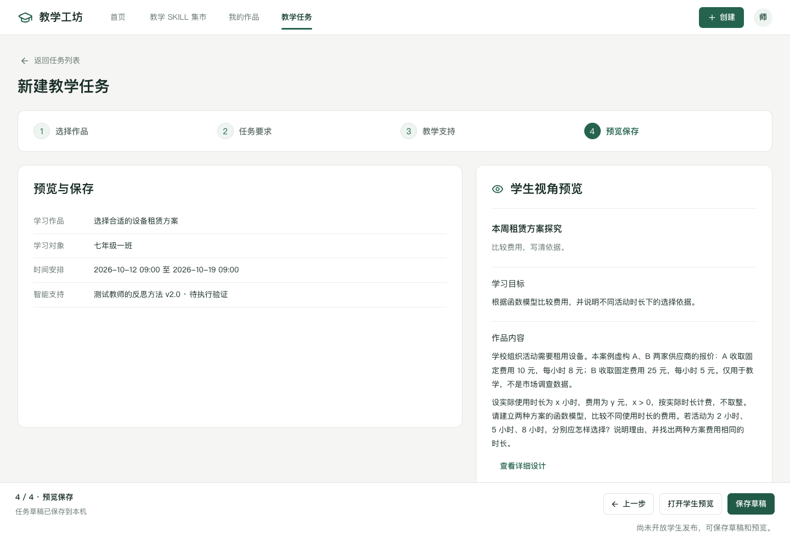

# 教学任务与 SKILL 应用

更新日期：2026 年 10 月 9 日。本文描述简化后的当前界面；旧文档中的双路径新建入口已取消。

## 教师只需分清两件事

“教学任务”是布置给学生的情境题目、任务链或 PBL 项目。“SKILL”是教师的教学方法，放在我的作品中管理。任务可选用已核对的方法作为教学支持，方法本身不会成为一道学生题目。

| 入口 | 流程 | 保存位置 |
| --- | --- | --- |
| 教学任务 → 新建教学任务 | 选择作品 → 任务要求 → 教学支持（可选）→ 预览保存 | 教学任务列表 |
| 我的作品 → 方法的“应用 SKILL” | 选择 SKILL → 选择任务 → 模拟检查 → 保存配置 | 我的作品中的“SKILL 应用配置” |

创建、核对、预览或分享方法都不新增教学任务。历史方法试用保留在我的作品的折叠区，不混入学生任务列表。

## 教学任务

作品列表只显示已保存且完成教师确认的情境题目、任务链和 PBL 项目，不混入 SKILL。一个搜索框按名称、学科和知识点查找，类型筛选与搜索共同生效。

任务名称、说明、对象、时间、提交方式、反馈时机和重试规则独立保存，不静默改写原作品。对象范围是当前配置记录，没有真实班级权限或学生账号。

第 3 步可以不使用教学支持。绑定方法时检查所属关系、教师核对状态、学段、学科和版本；不兼容时说明原因，不擅自扩大原方法范围。

保存后可恢复草稿、打开学生视角预览并在本机提交。提交只形成预览记录。已产生记录的任务保留内容快照，再修改时创建副本。

## SKILL 应用

从我的作品进入，用于已有教学任务。这里只配置方法的使用位置和介入范围，不提供学生任务的名称、时间和提交规则，也不能改写方法内部决策。

模拟依据教师填写的情境与触发判断展示已有方法步骤，不自动判断真实触发条件。实际执行、约束验证和退出结果明确保留为待验证。改变方法版本、目标或情境后，旧模拟失效。

最终操作是“保存配置”。当前未接入正式运行环境，不展示可操作的“启用 SKILL”或“发布任务”按钮。未开放的助手挂载收在“其他应用方式”，不占据主要路径。

## 保存与返回

- 刚打开的空白任务可以直接退出；选择作品或修改字段后才出现未保存提醒。
- 保存成功后地址带草稿 ID，刷新可继续；失败保留输入并停留原页。
- 公共导航、浏览器返回和详情页跳转均处理未保存内容，支持保存后继续或放弃修改。
- 从 SKILL 配置查看方法详情，顶部仍高亮我的作品；“返回 SKILL 配置”或“继续配置”恢复原草稿。
- 同一页面只保留必要的主要操作；最后一步不重复显示顶部与底部保存按钮。

## 路由与兼容

| 页面 | 路由 |
| --- | --- |
| 教学任务列表、新建任务 | #/space |
| 恢复任务或方法配置草稿 | #/space?draft=草稿ID |
| 从探究作品布置任务 | #/space?selection=design:作品ID:层级 |
| 从我的作品配置方法 | #/space?selection=skill:方法ID |
| 学生视角任务预览 | #/task/任务ID |
| SKILL 应用配置管理 | #/workshop?tab=skills |

沿用本机存储 teaching-method.market-workspace.v1，任务与方法配置为独立类型。旧数据、草稿 ID 和返回地址继续兼容，不清空用户资料。

## 视觉与检查

延续公共 AppHeader、Button、Dialog、Textarea、ViewTabs、DesignPreview 和 lucide 图标；保留绿色、白色及浅灰绿色体系。桌面工作台采用 6:4 分栏，窄屏用配置／实时预览标签切换，底部操作栏始终可见。

搜索框双边框和“类型”换行已修正。检查 1440、1120、768、390px 的搜索、筛选和无结果提示，图标不重叠、页面不横向溢出。完整检查证据见 [流程简化与需求核验](流程简化与需求核验.md)。

