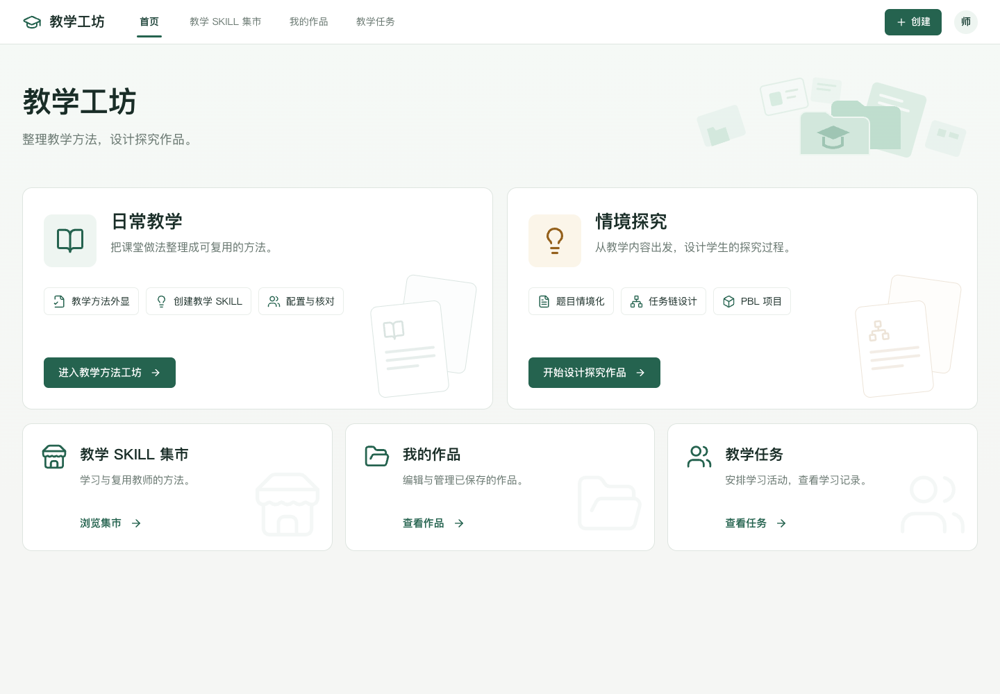
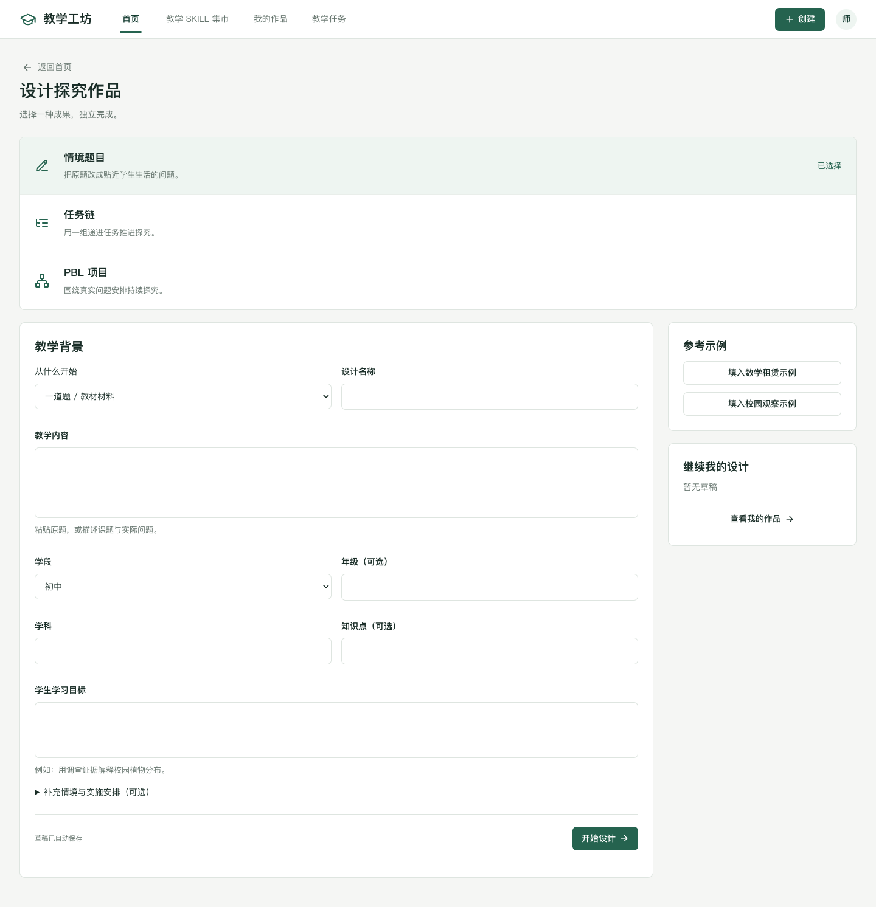

# 教学工坊 · 客户演示版本说明

更新日期：2026 年 10 月 8 日。此次修改只在本地完成，未上传 GitHub。

## 产品与视觉

平台提供日常教学、情境探究、教学 Skill 集市、我的作品、师生使用空间。客户展示界面取消 Demo、本机、前端实现等开发说明。教学方法、对话与报告中的预置内容仍以「示例」标识，避免把示例统计当成实际教学效果。

平台统一命名为「教学工坊」。「教学 Skill 集市」专门用于方法的发现、体验、收藏与复用；个人 Skill、情境题目、任务链和 PBL 项目在「我的作品」管理。情境作品的分享预览移到「我的作品 → 作品展示」，原有内容和分享标记保留。首页保留两个教学入口，下方显示集市、教师 Skill 工坊和师生使用空间。

最新版本统一为深绿与白色工作台：主色 `#25634F`、深绿 `#183F34`、浅绿 `#EEF5F1`、页面背景 `#F5F6F4`。首页采用简洁标题、两个等宽入口和下方轻量导航；创建页改为宽屏 3:7 双栏和编号字段组，探究、集市、作品和使用空间沿用同一套导航、表单与按钮。移动端保留完整操作和可见导航。详见 [全站 UI/UX 重构说明](UIUX统一重构说明.md)。

## 教师使用流程

日常教学：教学想法 → 六轮追问与方法编辑 → Skill 预览 → 教师逐项确认 → 我的作品或课堂试用。名称、条件、做法、原则均可编辑。编辑单项 Skill 不覆盖助手中的其他能力。

情境探究从教师的内容出发，不再照搬「三层模型」作为操作顺序：

1. 选择改编一道题、设计探究任务或策划探究项目。
2. 提供原题、知识课题或实际问题，填写学科和学生学习目标。年级、知识点、情境、时间可补充。
3. 进入对应工作区，修改教学背景、编辑成果并核对。
4. 独立保存成果，预览、导出、复制，或保存并用于教学。

每种成果独立完成。直接策划项目不会隐含生成一道数学题和一条任务链。教师可以按需拓展其他成果；这不是强制升级步骤。新建表单初始为空，数学租赁和校园植物观察示例由教师主动选用。两个示例均有完整题目、任务和项目内容，自定义内容不推断答案。

| 成果 | 教师可修改的内容 | 保存与使用条件 |
| --- | --- | --- |
| 情境题目 | 标题、情境、学生问题、目标、关键条件、参考要点、核对事项 | 必要字段完整，教师已核对。参考要点允许留空 |
| 探究任务链 | 每项任务的标题、要求、能力、产出、支持；添加、删除、排序 | 各项完整，教师已核对；不要求先保存情境题 |
| PBL 项目 | 驱动问题、目标、活动、阶段、资源、成果、展示、评价、实施安排 | 内容完整、五项实施条件确认、教师已核对；不要求先保存任务链 |

未确认条件可保留草稿，但不能作为完成的项目布置给学生。教学背景修改会保留教师编辑内容，同时撤销关联确认。使用空间检测所选成果是否仍有效，提示教师返回核对。

## 跳转与返回

- 顶部「创建」可以选择整理教学方法或设计探究活动。
- 作品分类 → 方法详情或作品编辑 → 返回原分类。来源写入地址，刷新后仍可返回。
- 集市筛选 → 详情 → 返回集市，保留搜索与筛选。
- 方法详情、我的作品、探究编辑 → 用于教学，自动选择对应内容。
- 使用空间 → 内容编辑或详情 → 返回使用空间，保留任务名称、说明与反馈。
- 创建学习任务 → 立即预览学生学习 → 返回教师使用空间。
- 教师试用记录、报告 → 学生视角 → 返回具体来源页。
- 单项 Skill 编辑 → 方法核对 → 返回编辑，保留 Skill 标识。
- 内容或记录已删除时显示恢复入口，不自动重建作品或替换成其他记录。

学生视角支持填写回答、刷新恢复、逐项推进、提交记录与查看教师预设提示。项目按阶段填写进展。已布置任务保存内容快照，后续修改或删除原作品不会改变此前任务。

## 技术边界与数据

这是客户演示用的本地前端版本，仍不新增后端服务或调用真实 LLM，不创建真实学生账号。分享展示仅更新浏览器数据，不上传公共平台。真实教学评价、跨设备账户、实际布置和模型执行尚未接入。展示文案与工程实现说明分开，后者保留在本文和 README 中。

| 数据位置 | 内容 |
| --- | --- |
| localStorage `teaching-assistant.frontend-demo.v2` | 既有助手、Skill、状态；兼容旧数据 |
| localStorage `teaching-assistant.method-draft.v1:{assistantId}[:{skillId}]` | 创建与单项编辑草稿 |
| localStorage `teaching-method.market-workspace.v1` | 探究作品、收藏、分享展示标记、学习任务与提交 |
| localStorage `teaching-method.task-draft:{taskId}` | 学生预览回答 |
| sessionStorage `teaching-method.inquiry-start.v1` | 未开始的探究表单 |
| sessionStorage `teaching-method.task-form.v1` | 教师布置任务的输入与选择 |
| sessionStorage `teaching-method.market-filters` | 集市搜索与筛选 |

新增 `shared/inquiry-workflow.ts` 统一独立成果准备、验证与使用条件；`shared/inquiry-examples.ts` 保存跨学科示例；`InquiryStartPage` 与 `InquiryBrief` 承担教学输入。路由保持旧地址兼容，增加来源、预览模式与使用空间内容选择参数。

## 启动与检查

在 `main/` 执行 `npm run dev`，访问 `http://127.0.0.1:5173/#/home`。服务仅监听本机地址。

`npm test` 覆盖领域状态、示例、来源解析、材料与模型协议；`npm run build` 执行类型检查和构建；`npm run test:e2e` 使用本机 Chrome 检查完整交互、来源返回、任务表单恢复、旧页面与 390px 手机布局。浏览器流程不调用收费模型服务。
