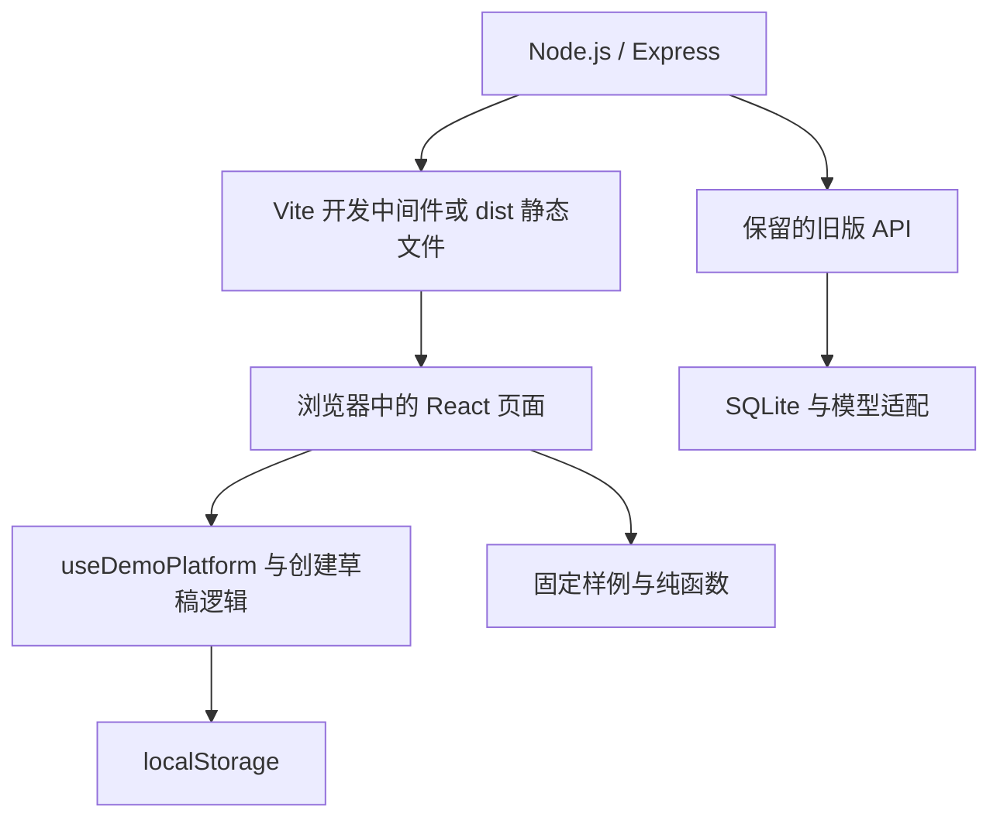

# 教学助手平台 · 升级前项目说明

> 本文保留「教法集市」升级前的实现记录。当前本地版本已新增双板块、三层情境设计、Skill 集市、工坊及任务预览，并修正固定 Skill 命名等问题。请以 [教法集市升级说明](教法集市升级说明.md) 为当前功能与操作依据。

版本：升级前本地 Demo 实现说明  
整理日期：2026 年 10 月 8 日  
项目名称：教学助手平台 / Educational Skill Builder  
阅读对象：产品负责人、教师、设计人员和开发人员

> 本文依据当前代码整理。文中区分“当前实现”“保留的后端能力”和“后续建议”，不把设计目标当作已经完成的功能。当前页面入口为 `src/App.tsx`；此前六步工作流的部分文档与后端代码仍保留，不能据此判断现在的界面。

## 1. 项目定位与核心价值

本项目是面向在职教师的教学助手构建工作台。教师通过描述具体教学问题、回答追问、确认自己的方法，将个人经验整理为结构化的 Educational Skill，再通过核对、试用和报告了解助手的行为。

项目关注的是“教师希望助手在什么情况下、按照什么顺序、采取什么教学行动”。例如，学生第一次做错题时，教师可能先询问思路；学生仍不能发现错误时，再给出方向性提示。这些条件判断与介入尺度，是需要保留的教学经验。

平台希望形成以下闭环：


当前版本跑通了这个闭环的前端交互。其中，追问、封装和方法核对具有确定的数据处理逻辑；学生对话、使用记录与报告主要使用固定示例。实际模型执行、真实学生使用和教学效果验证属于后续工作。

## 2. 面向哪些用户与场景

### 2.1 主要用户

主要用户是能够描述教学经验、但不熟悉提示词、模型参数和开发工具的教师。教师承担方法提供者、内容确认者与使用决定者的角色。

当前页面中的“张老师”是演示身份。顶部头像没有接入真实账户操作；浏览器内的助手数据也没有按登录账户隔离。

### 2.2 当前演示场景

首个完整样例为初中数学“一元一次方程练习”，聚焦学生答错后等待答案的问题。样例希望助手先引导学生回顾思路，再逐步提供帮助。

助手库还包含阅读、写作、实验探究、分层练习等展示条目。它们用于演示发现与浏览体验，不代表各学科已经具备完整、独立的运行能力。

创建页面允许选择小学、初中、高中、大学及多个学科，也可以输入自定义教学场景。不过，新 Skill 的名称与描述仍使用固定的错误反思样例，跨学科适配尚未完成。

### 2.3 适合当前 Demo 的任务

- 展示教师从自然语言到结构化方法的创建过程。
- 观察教师是否能理解、修改和确认“条件—做法”表达。
- 演示助手库、我的助手、方法核对、试用记录和报告之间的跳转。
- 让教师以学生身份输入内容，体验固定示例的交互方式。

## 3. 核心概念

| 概念 | 含义 | 当前载体 |
| --- | --- | --- |
| 教学想法 | 教师最初对问题、场景或做法的自然语言描述 | `originalIdea` |
| 教学方法 | 教师确认的问题、目标、启动条件、条件与做法、原则 | `TeachingMethod` |
| Educational Skill | 对已确认方法的结构化封装 | `EducationalSkill` |
| 教学助手 | 包含名称、目标、学段、学科、场景和 Skill 的配置对象 | `TeachingAssistant` |
| 方法核对 | 教师逐项确认条件、做法和原则是否准确 | 新创建流程的检测页面 |
| 学生视角预览 | 教师查看学生可能看到的对话界面 | `StudentPreviewPage` |
| 运行报告 | 对使用、技能触发和异常的汇总呈现 | 当前为固定页面样例 |

这里的 Skill 是本项目定义的教学能力数据结构。当前没有导出独立 `SKILL.md`、技能安装包或可供外部平台直接加载的产物，也没有训练或微调模型。

## 4. 当前页面与教师使用流程

### 4.1 助手库

入口为 `#/library`。页面默认展示 12 个内置助手，支持名称与目标搜索，以及学段、学科、活动筛选。

点击助手进入详情，查看教学对象、目标和技能摘要；“开始使用”进入简化对话页。该对话页使用固定回复，不调用真实教学模型。

教师在本地发布的助手会加入当前浏览器看到的助手库。这里的“发布”只是本地状态变化，没有上传到共享社区，也不会被其他设备上的教师发现。

### 4.2 我的助手

入口为 `#/mine`。页面展示本地保存的助手，支持创建、继续流程和确认删除。

点击助手后的页面由状态决定：草稿进入创建页，已生成或已检测进入检测页，试用中或已启用进入记录页。删除时清理助手、本地创建草稿、设计对话、技能排除设置和核对进度。

### 4.3 创建阶段一：说出教学想法

入口为 `#/create/:assistantId`。新建助手默认填入数学演示想法，教师可以直接体验，也可以修改成自己的内容。

需要填写的内容包括教学想法、学段、学科和可选教学场景。教学想法上限为 500 字符，场景上限为 40 字符。只有教学想法非空才能继续。

这一阶段不生成 Skill。`prepareMethod` 只初始化“想解决的问题”：默认数学想法转换为简短问题描述，其他输入沿用教师原文；已有问题内容不会被覆盖。

### 4.4 创建阶段二：梳理教学方法

页面左侧显示原始想法、已提交回答和当前问题，右侧显示逐步形成的教学方法。当前问题按固定顺序推进：

| 顺序 | 系统问题的关注点 | 写入的方法内容 |
| --- | --- | --- |
| 1 | 希望学生最终发生什么变化 | 预期结果 |
| 2 | 看到什么表现时开始介入 | 启动条件、第一步条件 |
| 3 | 通常先做什么 | 第一步做法 |
| 4 | 什么表现会改变下一步处理 | 第二步条件 |
| 5 | 接下来通常怎么处理 | 第二步做法 |
| 6 | 明确不希望助手做什么 | 教学原则 |

教师输入并提交后，回答会进入对话记录，相应字段即时更新。默认数学想法会在每轮预填示例回答；自定义想法的回答框初始为空，也可以主动使用示例回答。

右侧内容可直接编辑，还能补充或删除情况与做法、增加或删除原则。系统记录教师手动修改的字段，后续追问尽量不覆盖这些修改。

六轮结束后，系统询问：另一位教师完全按照右侧的方法去做，是否已经能够基本复现自己的做法。教师可以补充常见情况，也可以确认方法。

### 4.5 创建阶段三：查看并确认 Skill

教师确认方法后，系统通过纯函数封装 Skill，展示教学目的、适用条件、教学步骤和原则。教师可以返回修改方法。

“确认 Skill”将助手标记为 `GENERATED` 并进入核对页面。当前新流程每次封装生成一项 Skill，并以这项 Skill 替换助手的技能数组；不能将当前实现理解为完整的多 Skill 组合编辑器。

### 4.6 逐项核对

对于新流程生成、包含结构化 `steps` 的 Skill，检测页面按每组“条件—做法”生成一条核对记录。记录展示的是教师设定的做法，明确标为非模型回复。

教师逐项确认，可暂停和恢复；核对进度以技能内容签名保存，技能内容改变后不复用不匹配的进度。核对完成后状态为 `TESTED`，提供返回调整、进入我的助手和投放试用入口。

旧样例技能没有结构化 `steps` 时，仍使用固定数学测试情境与示例判断。这是旧版展示兼容路径，不能作为真实模型能力证据。

### 4.7 试用记录、报告与学生视角

“投放试用”将状态改为 `TRIAL` 并进入试用记录页面。当前没有向真实学生投放的过程。

记录页面支持查看全部或有异常的示例会话、进入示例详情、打开报告。报告展示固定的使用量、技能触发量和异常说明，例如 128 次对话、236 次技能触发、3 次异常以及固定日期区间。这些数据没有从当前助手的真实活动计算出来。

试用记录和试用报告都提供“打开学生端”。此入口进入教师专用的学生视角预览，支持输入、发送、选择示例问题和重新开始；返回时回到打开它的来源页面。

数学方程样例通过关键词判断返回固定回复。其他学科仅提供通用界面和“尚未配置固定对话回复”的说明。预览对话保存在页面状态中，离开或刷新后不作为运行日志长期保存，也不会更新报告数字。

### 4.8 本地发布

试用报告的“发布到助手库”将助手状态改为 `ACTIVE`、`isPublic` 改为 `true`，随后打开助手详情。

当前发布没有服务端审核、真实验证门槛、版本冻结或跨用户共享机制。`ACTIVE` 表示本地 Demo 中的流程状态，不等于助手已经通过真实模型检测或教学效果验证。

## 5. 如何引导教师充分表达自己的经验

### 5.1 已实现的引导方式

当前设计从具体事件出发，让教师依次表达目标、观察到的学生表现、首次行动、后续介入条件、后续行动和原则。问题使用教师熟悉的语言，并把每次回答实时展示在方法区，帮助教师检查遗漏和修正表达。

采用“当学生……，我会……”的表达，是为了把经验中的判断和行动放在一起。仅记录“采用启发式教学”无法明确助手下一轮应该说什么；记录“学生首次答错时，先请其解释从原式到当前结果的计算过程”才具备可观察性。

最后的“另一位教师能否复现”确认，为教师提供一次整体检查。额外情况与原则的入口允许教师超出固定六轮继续补充。

### 5.2 当前不能保证收集到全部想法

六轮问题是固定脚本，尚不能理解回答的含义、追问模糊内容、发现冲突或判断教学情境是否覆盖完整。因此，它能提供基本表达框架，但不能保证教师的隐性经验已被完全提取。

合理的完成标准应当限定在一个明确教学场景：教师确认主要情境、判断条件、行动、原则与例外足以复现。复杂教学经验可以分多次整理，不能只凭聊天结束就宣称收集完整。

### 5.3 后续引导机制建议

后续可在现有方法结构上增加以下机制，不必立即引入复杂智能体框架：

| 需要补足的经验 | 追问示例 | 应产生的结果 |
| --- | --- | --- |
| 判断依据 | “你根据学生哪句话或哪一步判断他没有理解？” | 可观察证据 |
| 行动细节 | “你会怎样问？能给一句常用的话吗？” | 可复现的示例表达 |
| 分支与例外 | “学生答对但说不出原因时，你还会这样处理吗？” | 分支条件 |
| 帮助尺度 | “第一次提示后仍卡住，你会增加多少帮助？” | 介入等级和边界 |
| 退出条件 | “出现什么表现后，你会停止提示？” | 结束条件 |
| 不适用情况 | “哪些学生表现或题型不适合这套方法？” | 适用范围 |
| 反例验证 | “这里给出的处理与你平时的做法一致吗？” | 教师纠正或确认 |

提问应优先处理缺失或模糊字段，每次聚焦一个问题；事实不明确时保留“待确认”。教师已经编辑和确认的内容应受到保护，系统不能静默改写。

## 6. 教师智慧如何转化为 Skill

### 6.1 当前转换逻辑

当前 Skill 由 `packageTeachingMethod` 封装，不调用模型。其输入必须包含非空问题、预期结果、启动条件，以及至少一组完整的条件与做法。教学原则可以为空。

| 教师方法字段 | Skill 字段 | 当前处理 |
| --- | --- | --- |
| `expectedOutcome` | `purpose` | 原样保留 |
| `trigger` | `trigger` | 原样保留 |
| `teachingSteps` | `steps` | 复制每组条件与行动 |
| `teachingSteps` | `behaviorSteps` | 派生为“当：条件 / 我会：行动”的兼容文字 |
| `principles` | `constraints` | 保留非空原则 |
| `problem` | 没有独立对应字段 | 保存在创建草稿中，不单独写入 Skill |
| 原始想法和问答 | 没有独立对应字段 | 保存在创建草稿中 |

当前 `name` 固定为“错误后的自主反思引导”，`description` 和 `summary` 也采用固定反思样例描述。因此，目的、条件、步骤和原则来自教师最终确认的内容，但名称与简介尚未随不同教学方法适配。

### 6.2 一个完整例子

教师想法：

> 学生做错题以后经常等答案。我希望第一次做错的时候不要马上告诉他答案，而是先让他看看自己的思路哪里有问题。

经过问答和确认，可形成以下方法：

| 部分 | 教师确认的内容 |
| --- | --- |
| 问题 | 学生答错后容易依赖直接答案 |
| 目标 | 回顾思路，尝试自主发现问题 |
| 启动条件 | 学生第一次答错，而且尚未意识到问题 |
| 第一步 | 请学生回顾刚才的解题思路 |
| 第二步条件 | 回顾后仍未发现问题 |
| 第二步做法 | 提醒学生检查可能出错的步骤，保留自主发现机会 |
| 原则 | 第一次答错不直接给完整答案 |

封装后的 Skill 可用下面的结构表达。此处是教学能力数据示例，不是当前已经执行的模型请求：

```json
{
  "name": "错误后的自主反思引导",
  "purpose": "让学生回顾思路，尝试自主发现问题",
  "trigger": "学生第一次答错，而且尚未意识到问题",
  "steps": [
    {
      "condition": "学生第一次答错，而且尚未意识到问题",
      "action": "请学生回顾刚才的解题思路"
    },
    {
      "condition": "回顾后仍未发现问题",
      "action": "提醒学生检查可能出错的步骤，保留自主发现机会"
    }
  ],
  "constraints": ["第一次答错不直接给完整答案"]
}
```

### 6.3 从结构化数据到真实执行还缺什么

结构化封装完成后，仍需把 Skill 编译为教学模型的执行指令，明确适用范围、触发判断、行为顺序、约束、退出条件和多个 Skill 冲突时的处理方式。

当前旧后端的 `compileInstructions` 接受旧版 `Agent` 和 `Skill.instruction`，新流程的 `EducationalSkill` 使用 `purpose / trigger / steps / constraints`。二者没有自动接通，不能直接把旧编译器视为新 Skill 的运行引擎。

后续应保留教师原话、提问、整理结果和确认记录之间的对应关系。系统补充的内容需要单独标识并由教师确认；没有依据的策略不应自动写入正式 Skill。

## 7. 助手状态与数据保存

### 7.1 状态

| 状态 | 含义 | 常见进入方式 |
| --- | --- | --- |
| `DRAFT` | 草稿，方法尚未最终确认或正在修改 | 新建、编辑 |
| `GENERATED` | 已确认 Skill，进入核对 | 确认 Skill |
| `TESTED` | 当前核对流程完成 | 逐项确认结束 |
| `TRIAL` | 本地试用阶段 | 投放试用 |
| `ACTIVE` | 本地已启用或发布状态 | 发布到助手库 |

共享模块定义了允许的状态转换规则，相关单元测试覆盖这些规则。但当前前端 Hook 通过直接更新状态推进，未统一调用该转换函数；状态规则与页面执行之间仍有接入工作。

编辑教学方法时，前端会将助手退回草稿并取消公开状态。新核对进度以技能内容判断是否可恢复。完整的不可变版本、历史报告关联和跨版本证据失效机制尚未覆盖当前全部页面。

### 7.2 当前本地存储

| 存储键 | 内容 |
| --- | --- |
| `teaching-assistant.frontend-demo.v2` | 助手列表与状态 |
| `teaching-assistant.method-draft.v1:<id>` | 原始想法、方法、问答、阶段、手动编辑记录 |
| `teaching-assistant.check-progress:<id>` | 核对进度和技能内容签名 |
| `teaching-assistant.excluded-skills.v1` | 兼容旧设计器的技能排除设置 |
| `teaching-assistant.designer-messages.v1` | 兼容旧设计器的设计对话 |

创建草稿在修改时写入 `localStorage`，支持刷新恢复和保存退出。它依赖同一浏览器与同一网站来源；清除浏览器数据、更换浏览器或端口后，不能保证看到原草稿。当前没有跨设备同步或独立导出备份入口。

学生视角预览与简化使用页的对话仅存在 React 状态中，不写入上述长期存储。

## 8. 技术架构与代码组织

### 8.1 当前实际链路



Express 负责本机服务与前端托管。当前教师页面主要通过本地 Hook、共享纯函数和样例数据运行；已读取的创建与学生预览 E2E 测试明确检查流程不发起 `/api/` 请求。

### 8.2 技术栈

| 层级 | 技术 |
| --- | --- |
| 前端 | React 19、TypeScript、Vite 7 |
| 界面与样式 | Tailwind CSS 4、现有 CSS 视觉系统、shadcn 风格组件、Radix、lucide-react |
| 服务端 | Node.js 24、Express 5、tsx |
| 数据库 | Node 内置 SQLite、WAL 模式 |
| 数据校验 | Zod |
| 文档解析 | pdf-parse、mammoth、Multer |
| 单元与集成测试 | Node 内置测试运行器、assert |
| 浏览器测试 | Playwright、本机 Chrome |

### 8.3 主要目录

```text
main/
├── src/
│   ├── App.tsx                    页面组合与状态驱动跳转
│   ├── components/                顶部导航、图标与基础组件
│   ├── data/platform.ts           前端助手与运行记录样例
│   ├── hooks/useDemoPlatform.ts   本地助手管理
│   ├── lib/routes.ts              Hash 路由
│   ├── features/library/          助手库、详情、我的助手
│   ├── features/designer/         教学想法、追问与 Skill 预览
│   ├── features/testing/          方法核对和旧样例检测展示
│   ├── features/usage/            记录、报告、使用、学生视角预览
│   └── styles/                    页面样式与响应式布局
├── shared/
│   ├── assistant.ts              新平台助手、Skill、状态类型
│   ├── teaching-method.ts        六轮问题、方法更新、Skill 封装
│   ├── schema.ts                 旧工作流 Zod 数据结构
│   ├── domain.ts                 旧 Agent 编译、失效、启用规则
│   └── workflow.ts               旧六步进度规则
├── server/
│   ├── index.ts                  服务入口和已注册 API
│   ├── auth.ts                   保留的账户与会话接口
│   ├── store.ts                  数据表初始化
│   ├── models.ts                 设计与教学模型适配
│   ├── evaluation.ts             旧 Agent 检查与评审
│   ├── materials.ts              文件文字提取
│   └── platform/                 平台种子与 Mock 辅助函数
├── tests/                        单元、集成与 E2E 测试
└── docs/                         设计资料与本说明书
```

## 9. 保留的后端能力及其接入状态

### 9.1 已注册的接口

| 接口 | 作用 | 与当前页面的关系 |
| --- | --- | --- |
| `GET /api/status` | 返回旧后端模型配置状态 | 当前新页面未以它驱动创建过程 |
| `/api/auth` 下的账户接口 | 查询身份、注册、登录、退出 | 当前顶部演示账户未接入 |
| `POST /api/design` | 需求转换为旧版 Brief 和 Skill | 新六轮追问未调用 |
| `POST /api/materials` | 提取上传材料的文字 | 当前创建流程无材料上传入口 |
| `POST /api/chat` | 旧版 Agent 的教学对话 | 当前学生视角预览未调用 |
| `POST /api/evaluate` | 旧版 Agent 配置检查与模型评审 | 新方法核对未调用 |
| `GET /api/projects` | 读取登录用户的旧项目 | 当前助手列表使用本地数据 |
| `PUT /api/projects/:id` | 保存旧项目 JSON | 当前新助手未同步到此接口 |
| `DELETE /api/projects/:id` | 删除登录用户的旧项目 | 当前删除清理本地助手数据 |

当前 `server/index.ts` 没有注册新助手的增删改查、Skill 封装、试用会话或新平台报告接口。不能只因为存在平台数据库表或 Mock 函数，就认定完整平台服务已经可调用。

### 9.2 设计与教学模型

旧后端分别配置 `DESIGN_MODEL_URL / NAME / KEY` 和 `TEACHING_MODEL_URL / NAME / KEY`。两个角色都具备 URL 与名称时，`modelStatus` 才进入 `live`；否则进入 `demo`。密钥是否需要取决于接口，当前模式判定没有强制要求 KEY。

模型适配采用 Chat Completions 兼容协议。设计模型负责需求整理与辅助评审，教学模型负责实际回答。旧后端的真实评审流程会生成三道短测试、调用教学模型、再以设计模型判断回答是否满足预期；配置错误或调用失败会明确报错，不降级冒充真实成功。

这些能力目前服务于旧数据结构。即使配置了模型，也不会自动让新创建页面、学生视角预览或报告变成真实模型流程。

### 9.3 SQLite 数据表

默认数据库为 `main/data/workspace.sqlite`。除账户、会话和旧项目表外，还初始化了助手、设计对话、技能、助手版本、检测任务、检测题、检测结果、使用会话、使用消息、异常和运行报告等平台表，并写入演示种子数据。

当前页面没有读取这些平台表。平台表中的技能列主要保存 `purpose / trigger / behavior_steps / constraints`，尚未完整承接新创建草稿的问答、手动编辑来源和结构化 `steps`。后续服务端接入需要处理数据结构与迁移，而不是仅替换前端存储地址。

### 9.4 材料与安全能力

旧材料接口支持 PDF、DOCX、TXT、MD，上传单文件限制 5MB、提取文字限制 16,000 字符；旧 Agent 限制最多 5 份材料、合计 24,000 字符。上传后使用提取文字，不长期保留原始文件。旧指令编译器明确将材料视为数据，禁止材料中的指令覆盖教学规则。

账户实现使用 scrypt 密码哈希、随机会话 token、HttpOnly 与 SameSite=strict Cookie，并提供登录频率限制。API 对带有 Origin 且与 Host 不同源的非 GET 请求进行拒绝。这些是现有实现描述，不能替代正式上线前的完整安全审查。

服务固定监听 `127.0.0.1`。密钥保留在服务端环境变量中，不应写入前端、文档或日志。当前定位为本机 Demo。

## 10. 后续后端业务逻辑建议

以下为接通当前产品流程的建议，尚未实现。

### 10.1 教师经验整理服务

以一个创建会话保存原始想法、学段学科、场景、问答、方法草稿、确认记录和版本。每轮输入先检查格式，再判断缺失信息，返回下一问题与建议更新字段。

模型主要帮助提出问题、抽取条件与行动、发现模糊表达或冲突。教师对方法具有最终决定权。服务端应保留字段来源，并把教师确认与系统建议区分开。

### 10.2 Skill 封装与版本服务

确认后由服务端统一校验方法完整性，创建带版本的 Skill。至少保留目的、适用条件、条件与行动、原则、教师来源、确认时间和版本关联；后续按需要扩展退出条件、例外与示例。

Skill 名称和简介应依据方法生成，并允许教师确认。多个 Skill 的组合需要明确优先级与冲突处理，例如“提供更具体提示”与“禁止直接代答”同时触发时如何执行。

### 10.3 教学执行服务

从已确认版本编译教学指令，将对话作为学生输入数据传递给教学模型。记录会话、使用版本、实际回复、模型配置和可观察行为。

Skill 激活记录应说明来源：显式路由规则、模型结构化声明或评审推断。模型声称触发某技能，不应直接被视为已经正确执行该技能。

### 10.4 验证与报告服务

区分三种证据：配置是否完整、实际回复是否符合方法、学生学习是否发生变化。前两种可通过程序检查和对话评审支持；学习效果需要真实学生数据与合适的评价设计，不能由几次演示回答推定。

报告应从当前版本的真实事件计算，并能追溯到会话和回复。无数据时显示待验证；修改方法后创建新版本，让新旧检测、会话和报告分别关联相应版本。

### 10.5 社区与发布服务

真正的共享助手库需要身份、所有权、可见性、发布版本和撤回机制。试用、个人启用与公开发布应有明确不同的业务含义。

服务端接入顺序宜先完成持久化和方法确认，再接通真实教学执行与验证，最后开放跨教师共享。首个闭环可以继续限定数学样例，避免同时承诺多学科全部能力。

## 11. 实现程度与已知限制

| 能力 | 当前状态 |
| --- | --- |
| 助手库搜索、筛选、详情 | 前端已实现，使用样例与本地发布数据 |
| 我的助手、草稿恢复、确认删除 | 前端已实现，依赖当前浏览器 |
| 六轮交互提问、方法编辑、补充情况与原则 | 已实现，问题顺序固定 |
| 教师方法到 Skill 的结构化封装 | 已实现，纯函数，无模型调用 |
| 通用 Skill 名称与简介 | 尚未实现，仍为固定反思样例 |
| 多 Skill 组合与独立修改 | 数据结构可容纳，当前新流程生成并替换为单项 |
| 方法逐项核对 | 已实现，不是模型表现检测 |
| 学生视角预览 | 已实现，固定示例回复，无真实学生账户 |
| 真实对话持久化与统计 | 当前前端未实现 |
| 试用记录、报告 | 固定示例展示，部分页面缺少明显的 Demo 标记 |
| 发布与社区共享 | 仅本地状态更新 |
| 认证、文件解析、模型适配 | 旧后端保留，新页面尚未接通 |
| 真实教学效果验证 | 尚未实现 |

需要优先处理的产品问题包括：统一报告和旧使用页的演示标识；避免固定统计被理解为真实证据；让名称与简介适配教师的方法；统一新旧 Skill 数据结构、版本和状态规则。

此前文档中的“六步向导”“创建阶段上传材料”“已有技能只替换选中项”等描述，不完全对应当前页面。以本文和当前代码作为现阶段说明；历史设计材料作为背景资料保留。

## 12. 运行与验证

### 12.1 本地运行

需要 Node.js 24，在 `main/` 目录执行：

```bash
npm install
npm run dev
```

入口为 `http://127.0.0.1:5173/#/library`。开发模式下 Express 托管 Vite 中间件，前端与 API 共用端口。服务进程退出后需要重新启动。

生产构建与本机运行：

```bash
npm run build
npm start
```

`build` 先进行 TypeScript 类型检查，再生成 `dist/`；`start` 由同一 Express 服务托管构建产物，仍监听本机地址。

### 12.2 测试与覆盖范围

```bash
npm test
npm run test:e2e
```

E2E 需要本地服务已启动，并安装本机 Chrome。现有测试包括：

| 测试组 | 覆盖内容 |
| --- | --- |
| `teaching-method.test.ts` | 六轮回答、手动编辑保护、封装、完整性校验 |
| `creation-flow.spec.ts` | 实际填写与提交、返回修改、刷新恢复、无 API 请求、390px 布局 |
| `trial-preview.spec.ts` | 两个试用入口、示例发送、重置、返回来源页、无 API 请求、窄屏 |
| `workflow.spec.ts` | 助手库搜索筛选、详情跳转、确认删除 |
| `assistant-platform.test.ts` | Skill 结构、状态规则、筛选与使用汇总 |
| `platform-services.test.ts` | 平台 Mock 辅助函数行为 |
| `domain / workflow-state` | 旧工作流版本、失效、相邻步骤与启用条件 |
| `materials / models` | 文件实际解析、模型协议、评审和失败行为 |

本说明书整理时阅读了实现与测试定义，没有重新执行构建或全量测试。测试覆盖说明不等于本次运行结果；现有测试也不能证明真实模型的教学表现。

### 12.3 建议演示路径

1. 从助手库查看数学助手，再进入创建助手。
2. 使用预填想法进入方法整理，修改至少一轮回答并观察右侧变化。
3. 完成六轮问题，补充一种情况，确认可复现的方法。
4. 查看 Skill，返回修改一次，再确认进入核对。
5. 逐项确认后进入试用记录，打开试用报告和学生视角。
6. 发送示例输入、重置并返回；说明报告数字为固定样例。
7. 发布到本地助手库，演示重新进入和草稿保存。

## 13. 下一阶段建议与验收标准

| 阶段 | 核心工作 | 可检查的完成标准 |
| --- | --- | --- |
| 第一阶段：统一 Demo 语义 | 修正固定名称、标记示例数据、整理状态和文档 | 教师能清楚分辨方法确认、模型验证与演示报告 |
| 第二阶段：接通持久化 | 新方法数据结构、账户、助手与版本 API | 同一教师刷新、重新登录后仍能恢复方法与版本；账户之间隔离 |
| 第三阶段：真实教学执行 | 新 Skill 指令编译、教学模型、会话记录 | 每次实际回复可追溯到模型和 Skill 版本；失败明确显示 |
| 第四阶段：验证闭环 | 情境测试、教师评审、异常与报告 | 报告来自实际会话；修改方法后旧证据不用于新版本判断 |
| 第五阶段：共享使用 | 发布版本、权限、撤回与社区发现 | 其他教师可以看到授权发布版本，原作者能管理可见性 |

项目的核心验收标准应是：教师能把一个明确场景中的经验表达完整，确认系统忠实保留了自己的判断与做法，并能基于实际对话证据判断助手是否执行了这套方法。

## 14. 代码与资料索引

以下路径相对于本说明书所在的 `docs/`：

- [页面入口与流程跳转](../src/App.tsx)
- [本地助手管理](../src/hooks/useDemoPlatform.ts)
- [教学方法与 Skill 封装](../shared/teaching-method.ts)
- [助手、Skill 与状态类型](../shared/assistant.ts)
- [交互追问与方法编辑](../src/features/designer/GuidedMethodPage.tsx)
- [创建阶段与草稿保存](../src/features/designer/DesignerPage.tsx)
- [方法核对数据生成](../src/features/testing/testData.ts)
- [教师查看的学生视角预览](../src/features/usage/StudentPreviewPage.tsx)
- [当前报告页面](../src/features/usage/ReportPage.tsx)
- [已注册的后端 API](../server/index.ts)
- [数据库表结构](../server/store.ts)
- [旧模型适配](../server/models.ts)
- [旧 Agent 指令编译与证据失效](../shared/domain.ts)
- [运行说明](../README.md)
- [历史项目设计](项目设计.md)
- [历史前端设计](前端重设计.md)

