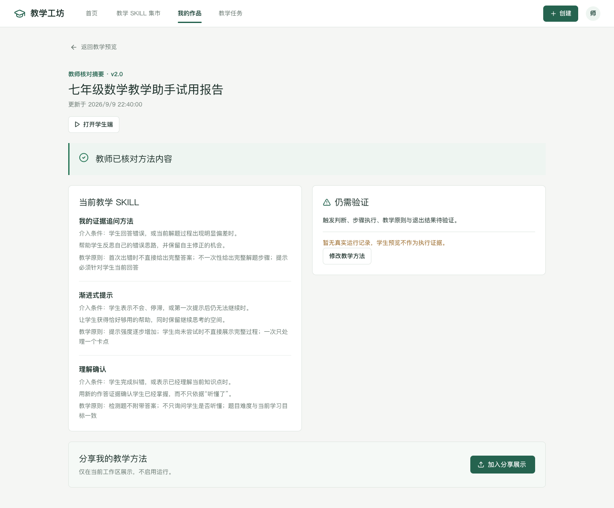

# 教学工坊：项目逻辑审查与修正

更新日期：2026 年 10 月 9 日。

本轮已审查当前主要页面的创建、核对、复用、应用、保存、预览、分享、删除与返回流程，并检查共享状态规则、存储读取、保留的服务入口和模型／材料逻辑。确认的问题已直接修正，改动保留在本地。

## 已修正的问题

| 原问题 | 修正后的行为 | 主要位置 |
| --- | --- | --- |
| SKILL 的入口叫“布置任务”，实际进入应用配置，混淆教师方法和学生作品。 | 方法使用入口改为“应用 SKILL”；情境作品仍可“布置任务”。 | `features/marketplace`、`features/workshop` |
| 学习活动查看方法后再次应用，可能错误恢复学习活动草稿。 | 只有同一方法的 SKILL 应用草稿才恢复；其他情况建立独立应用配置。 | `App.tsx`、`lib/routes.ts` |
| 从我的作品或教学任务查看方法，导航却始终高亮集市。 | 根据来源高亮对应工作空间；直接打开方法链接时默认归入集市。 | `AppHeader.tsx`、`lib/routes.ts` |
| 内部关闭、恢复草稿后地址和导航来源可能不同步。 | 保存地址保留草稿；退出工作台清除旧选择；导航读取当前地址；学生预览返回保留来源。 | `App.tsx`、`features/space/UsageSpace.tsx` |
| 报告、运行记录套用固定日期、数学方法、次数、百分比与异常。 | 展示当前方法、版本、更新时间和待验证事项；不生成虚构运行结论。 | `features/usage` |
| 旧格式语文等方法也套用数学方程核对案例。 | 根据该方法自己的条件和做法逐项核对，旧格式也保留原步骤。 | `features/testing/testData.ts` |
| 预置 ACTIVE 状态被当作教师已经核对。 | 预置内容从待核对开始；完成教师逐项确认后才记录核对状态。 | `TestingPage.tsx`、`useDemoPlatform.ts` |
| 方法封装后重新编辑，“想解决的问题”被目标替代。 | 单独保存并恢复 problem；保留教师的问题、目标、条件、步骤和原则。 | `shared/assistant.ts`、`shared/teaching-method.ts` |
| 条件和做法拼成一条过长文本，或超出八步／八条原则后仍能封装。 | 条件与做法分别保存；封装前检查容量与长度；不覆盖教师手动整理的原则。 | `shared/teaching-method.ts`、`MethodOutline.tsx` |
| 修改方法、范围或删除方法后，旧核对和版本信息可能继续有效。 | 方法与范围变化撤销核对和分享状态；删除方法递增版本并清除旧核对进度。 | `useDemoPlatform.ts`、`TestingPage.tsx` |
| 分享方法会直接把助手标为 ACTIVE，且报告分享未进入作品展示。 | 分享不改变运行状态；报告分享加入本机作品展示。 | `useDemoPlatform.ts`、`App.tsx` |
| 模拟只绑定活动 ID，活动内容变化后仍显示旧模拟有效。 | 模拟同时绑定方法版本、步骤、适用范围及目标活动内容；变化后需重新模拟。新增学习记录不改变配置证据。 | `shared/teaching-activity.ts`、`features/space` |
| 草稿和学生预览分两次保存，可能只保存一半却提示成功。 | 草稿和预览快照一次保存；失败保留输入和未保存状态。连续更新不会覆盖前一次修改。 | `useMarketWorkspace.ts`、`UsageSpace.tsx` |
| 学生提交保存失败仍显示“已提交”，一次提交约束只在界面检查。 | 持久化成功后才显示提交成功；保存失败保留回答；存储层也检查一次提交。 | `TaskPreview.tsx`、`useMarketWorkspace.ts` |
| 不完整活动配置保存后，旧学生预览仍被当成最新配置。 | 尚无记录的旧预览撤销，完成配置后重建；已有提交记录的历史快照保留。 | `useMarketWorkspace.ts` |
| PBL 空实施条件数组也被 every 判断为完成。 | 必须五项条件齐全且逐项确认；编辑后提示待核对，已保存分类仍保留。 | `shared/inquiry-workflow.ts`、`features/inquiry` |
| 新建探究作品继承旧时间／错误缓存，保存失败仍跳转。 | 只恢复教学背景字段；新建时间重新记录；创建／保存成功后才进入后续流程。 | `InquiryStartPage.tsx`、`InquiryEditor.tsx`、`useMarketWorkspace.ts` |
| 损坏的可选存储记录可能导致整个页面无法加载。 | 检查记录结构与草稿字段，健康作品仍可读取；保留可读旧格式，不用新容量限制删除历史内容。 | `shared/workspace-storage.ts`、存储 Hook、`DesignerPage.tsx` |
| 原共享启用规则允许空检测证据，演示模式可绕过 review。 | 空检测不能启用；任何 review 都阻止启用；演示模式只允许明确 pending，不冒充实际通过。 | `shared/domain.ts` |

## 当前功能含义

- **日常教学**：将教师经验整理为方法，经教师确认后封装成 SKILL。内容核对不等于 Agent 执行验证。
- **情境探究**：编辑并分别保存情境题目、任务链和 PBL 项目；每种成果独立确认。
- **教学 SKILL 集市**：浏览、收藏、查看固定表达并复用方法。收藏不代表取得运行授权。
- **我的作品**：管理方法、探究成果、收藏和本机分享展示；旧助手入口保留兼容。
- **教学任务**：学习活动与 SKILL 应用使用两个独立配置对象。学习活动可以保存并打开学生预览；SKILL 应用可以保存配置和规则模拟。
- **学生端入口**：教师查看学生视角的本机预览，不是正式学生账户或已发布任务。
- **教学预览／试用报告**：当前方法步骤与核对摘要，不是学生运行统计。

真实学生发布、SKILL 运行环境、教师助手正式挂载和跨设备同步仍未接入。相关正式操作保持不可执行。适用范围的自动检查目前限于学段、学科、版本等明确字段，不声称完成教学情境的语义判断或学习效果验证。

## 检查结果

- `npm run build`：TypeScript 与 Vite 构建通过。保留既有 Zod 注释与产物体积提示，不影响构建。
- `npm test`：54 项单元／集成检查通过；存储读取调整后另通过 18 项相关检查。
- 浏览器检查分批覆盖全部 39 项 E2E 场景，最终全部通过。初次因预览服务停止而无法连接，恢复服务后重新验证；旧文案断言按实际新含义更新。
- 新增 8 项审查回归，覆盖保存失败、草稿对象分离、分享状态、删除失效、原子保存、预置内容核对、损坏存储和旧预览撤销。
- 桌面、平板与手机页面已检查；报告和方法预览补查 1440／390px，无横向溢出。收集运行时／控制台错误的相关场景未发现新错误。
- 测试未调用收费真实模型。模型协议检查使用本机夹具。

本地预览：[教学工坊](http://127.0.0.1:5173/#/home)；活动入口：[教学任务](http://127.0.0.1:5173/#/space)。

