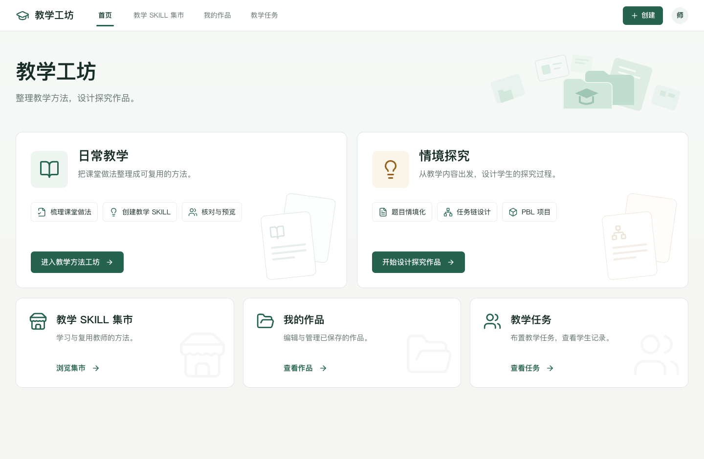
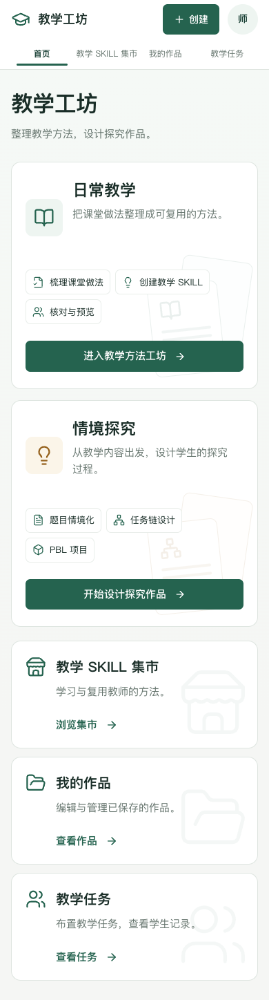

# 首页改版说明

更新日期：2026 年 10 月 9 日。

## 设计与范围

根据提供的首页参考图进行保留品牌的页面重设计。面向教师，首页负责选择教学方法梳理或情境探究，并提供集市、作品和任务入口。采用适合电脑浏览的左右核心卡片与三列次要入口，窄屏改为单列。

保留现有 Logo、`AppHeader` 导航、绿色配色、系统中文字体、Button 和路由接口。仅替换首页模块，不改变日常教学、探究、集市、作品或任务页面的业务逻辑。没有作品统计、进度或虚构数据。

颜色沿用 `--primary`（#25634F）、`--secondary-foreground`（#183F34）、`--card`（#FFFFFF）、`--blue-soft`（#EEF5F1）、`--ink-2`（#66756E）与淡橙色变量。首页标题约 40px，核心标题 26px，正文 16px，说明标签 14px。间距采用 8px 的节奏；内容最大宽度 1560px，卡片圆角 14px，默认无明显阴影。

设计取向：稳定的对称布局、仅响应操作的短过渡、适中的入口信息密度、轻量教育文档装饰、严格沿用品牌。装饰使用既有 `workshop-folders.svg` 和 lucide 图标，保持低对比，隐藏于辅助技术且不接受鼠标事件。没有动画插画、外部字体或新增依赖。

## 修改文件与复用

| 文件 | 改动 |
| --- | --- |
| `src/features/marketplace/HomePage.tsx` | 新的首页组件：横向品牌区、两个核心入口、三个次要入口；说明标签不作为按钮。 |
| `src/features/marketplace/home.css` | 首页专用样式，选择器限定在首页；桌面两列／三列，窄屏单列。 |
| `src/features/marketplace/LandingPages.tsx` | 将 HomePage 转为新组件的导出入口，保留原导入接口及 DailyPage。 |
| `tests/home.spec.ts` | 五个入口、键盘操作、导航激活、没有统计模块、响应式布局和控制台检查。 |
| 本文与 `docs/assets/新版首页-*.png` | 实施说明与桌面、手机预览。 |

直接复用现有 `AppHeader`、`Button`、`.page-frame`、全站颜色及字体变量、lucide 图标和 `public/workshop-folders.svg`。项目没有公共 Card 组件，因此首页卡片使用语义化 article 和既有 Button 组合，不新增全站卡片系统。

## 入口路由

| 首页入口 | 原有目标流程／路由 |
| --- | --- |
| 进入教学方法工坊 | `#/create/:assistantId`；点击时按原方式创建独立标识，从「教学想法」开始。 |
| 开始设计探究作品 | `#/inquiry`；保留探究入口选择，不强制进入任务链或 PBL。 |
| 浏览集市 | `#/market`。 |
| 查看作品 | `#/workshop?tab=skills`。 |
| 查看任务 | `#/space`。 |

顶部 Logo、四个导航项、「创建」弹窗和头像入口继续使用公共导航组件。原 `#/daily` 入口及该页内容保持原样。

## 检查结果

- `npm run build`：TypeScript 检查与 Vite 构建通过；构建仍有既有产物体积和 Zod 注释提示，不阻断输出。
- 首页及相关页面的 6 项 E2E 场景通过，包括五个入口、统一导航、集市与作品返回、方法复用，以及跨页面响应式检查。
- 首页检查 1672、1440、1024、768、390px：桌面核心卡片等高、顶部与按钮对齐，窄屏改为单列，没有横向溢出，主按钮高度至少 44px。
- 进入创建、探究、集市、作品和教学任务时，没有捕获新的运行时或控制台错误。
- 首页没有作品数量统计、进度条或虚构状态；功能标签是说明文本，可键盘操作的入口保持明确。

执行命令（本地预览保持运行）：

```bash
npm run build
npm run test:e2e -- tests/home.spec.ts tests/customer-navigation.spec.ts tests/marketplace.spec.ts tests/workbench-ui.spec.ts --grep '首页|页面|方法详情返回'
```

本地预览：[教学工坊首页](http://127.0.0.1:5173/#/home)。




